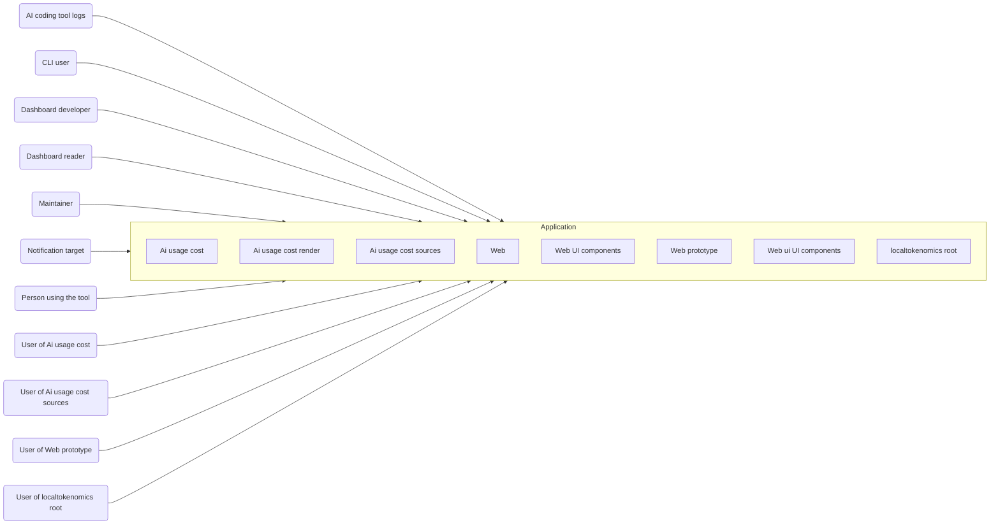

# localtokenomics context

## Description

Legend: rounded boxes are people or outside services; the boxes inside Application are its systems. Drawn from the actor and system notes; it shows who reaches the application, not each call.

## Diagram

