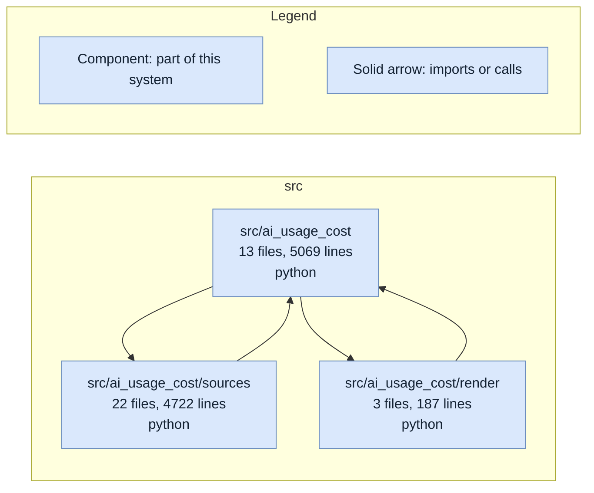
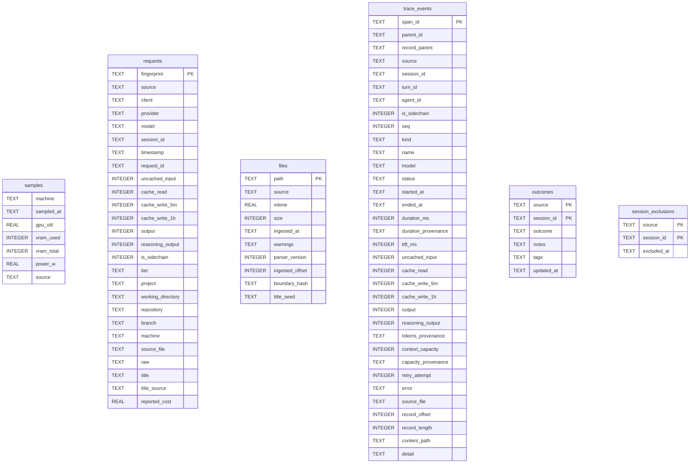

# Ai usage cost Diagrams

Generated views of the Ai usage cost chunk; hand-laid views are added next to them.

## Hand-laid views

| Kind | Diagram | Question it answers |
|---|---|---|
| Conceptual model | [[Usage cost conceptual model]] | What are the things the tool talks about? |
| State | [[Cost state of a request]] | Which cost state can a request end in? |
| Sequence | [[Scan pipeline from logs to report]] | In what order do the parts work during a scan? |
| Decision flowchart | [[How one request is priced]] | What settles the price of one request? |
| Data flow | [[Usage data flow]] | Where does the data come from, rest and go? |
| BPMN | [[Scan and report process]] | What is the scan as a process between a person and the tool? |
| Mind map | [[Usage cost concepts]] | What is the core made of, in one picture? |
| API map | [[Usage cost HTTP routes]] | Which addresses does the dashboard call, and which ones change data? |
| Use case diagram | [[Usage cost goals]] | What can a person get done, and who else takes part? |
| Class diagram | [[Usage cost types]] | Which in memory types carry a request from log to report? |
| Data lineage | [[Where usage cost data comes from]] | Where does each stored table get its data, and who reads it? |
| Activity | [[Spend alert run]] | What happens in one run of the spend alert? |
| Timeline | [[Store schema versions]] | In what order did the store gain its tables and columns? |
| Gantt | [[Alert comparison windows]] | Which days does the alert compare? |
| Error flow | [[Usage cost refusals]] | How does the core refuse, and what does it absorb quietly? |
| Glossary map | [[Usage cost terms]] | How do the domain words relate? |
| Package tree | [[Usage cost folders]] | How is the package laid out on disk? |

The conceptual model also serves as the conceptual data model (kind erd-conceptual).

The container view below is the C4 view and the entity view is the physical model of the store.

## Components around Ai usage cost

%% generated:diagram-module-ch-localtokenomics-src-ai-usage-cost start (do not edit; run brain docs generate) %%

%% generated:diagram-module-ch-localtokenomics-src-ai-usage-cost end %%

## Entity relationship view of Ai usage cost

%% generated:diagram-er-ch-localtokenomics-src-ai-usage-cost start (do not edit; run brain docs generate) %%

%% generated:diagram-er-ch-localtokenomics-src-ai-usage-cost end %%
