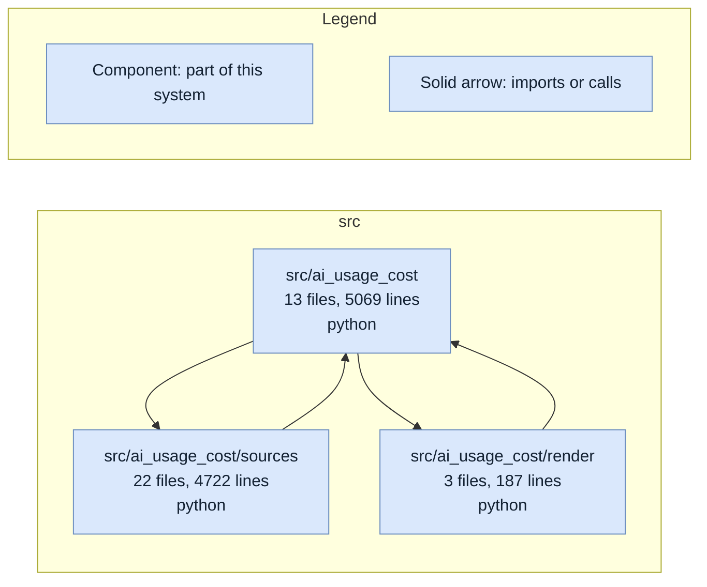

# Ai usage cost Diagrams

Generated views of the Ai usage cost chunk; hand-laid views are added next to them.

## Hand-laid views

| Kind | Diagram | Question it answers |
|---|---|---|
| Conceptual model | [[Usage cost conceptual model]] | What are the things the tool talks about? |
| State | [[Cost state of a request]] | Which cost state can a request end in? |
| Sequence | [[Scan pipeline from logs to report]] | In what order do the parts work during a scan? |
| Decision flowchart | [[How one request is priced]] | What settles the price of one request? |
| Data flow | [[Usage data flow]] | Where does the data come from, rest and go? |
| BPMN | [[Scan and report process]] | What is the scan as a process between a person and the tool? |

The container view below is the C4 view and the entity view is the physical model of the store.

## Components around Ai usage cost

%% generated:diagram-module-ch-localtokenomics-src-ai-usage-cost start (do not edit; run brain docs generate) %%

%% generated:diagram-module-ch-localtokenomics-src-ai-usage-cost end %%

## Entity relationship view of Ai usage cost

%% generated:diagram-er-ch-localtokenomics-src-ai-usage-cost start (do not edit; run brain docs generate) %%

%% generated:diagram-er-ch-localtokenomics-src-ai-usage-cost end %%
