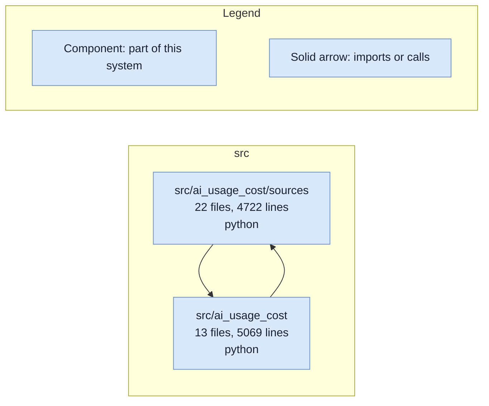

# Ai usage cost sources Diagrams

Generated views of the Ai usage cost sources chunk; hand-laid views are added next to them.

## Components around Ai usage cost sources

%% generated:diagram-module-ch-localtokenomics-src-ai-usage-cost-sources start (do not edit; run brain docs generate) %%

%% generated:diagram-module-ch-localtokenomics-src-ai-usage-cost-sources end %%
