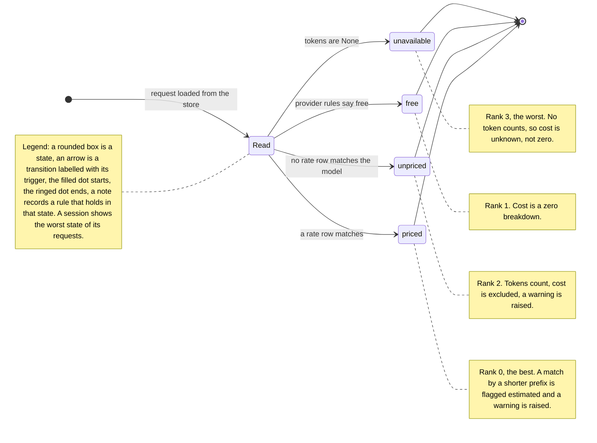

# Cost state of a request

Every request ends in exactly one of four cost states, and the state decides whether its cost is counted. This view shows what puts a request into each state and how the states are ranked when a session is shown. It explains why a session can be marked unpriced even when most of its requests have a price.

## What the diagram shows

- The four states are priced, free, unpriced and unavailable. `src/ai_usage_cost/models.py:8`
- A request with no token counts is unavailable, which is not the same as free. `src/ai_usage_cost/pricing.py:421`
- A provider whose rules say free gives the free state and a zero cost breakdown. `src/ai_usage_cost/pricing.py:422` `src/ai_usage_cost/pricing.py:434`
- A request whose model matches no rate row is unpriced, so its tokens are counted but its cost is left out. `src/ai_usage_cost/pricing.py:425`
- Every other request is priced. `src/ai_usage_cost/pricing.py:426`
- A match through a shorter prefix keeps the priced state but sets the estimated flag. `src/ai_usage_cost/pricing.py:313`
- The pipeline raises a warning for each estimated model. `src/ai_usage_cost/pipeline.py:225`
- A session shows the worst state among its requests, ranked priced 0, free 1, unpriced 2 and unavailable 3. `src/ai_usage_cost/aggregate.py:20` `src/ai_usage_cost/aggregate.py:640`

## Capability and related functionality

- Realises the cost honesty rule described in [[Ai usage cost Overview]]: unknown cost is never shown as zero.
- The decision that picks the state is expanded in [[How one request is priced]].
- The fields that carry the state are listed in [[Ai usage cost Data Model]].

## The diagram

%% generated:diagram-state-request-cost-state start (do not edit; run brain docs generate) %%

%% generated:diagram-state-request-cost-state end %%

> [!example]- Code references
> | Code | What it shows |
> |---|---|
> | `src/ai_usage_cost/pricing.py:417` | The decision of the state |
> | `src/ai_usage_cost/pricing.py:429` | Where the state is used to skip or compute the cost |
> | `src/ai_usage_cost/aggregate.py:570` | The worst-state roll up for a session |
