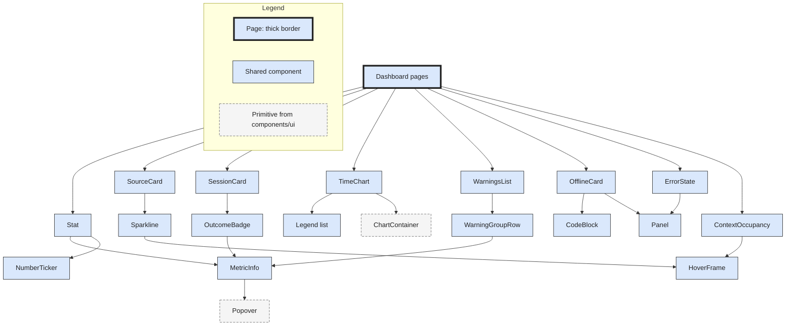

# Dashboard component composition

This tree shows which shared component draws which other component. It helps a developer see that one hover frame and one info box serve many parts, so a fix there reaches every screen. It also marks where the tree ends at the basic interface parts.

## What the diagram shows

The dashboard pages place the shared components: the overview page uses the stat card, the source card and the time chart, the sessions page uses the session card, the sources page uses the warnings list, the context tab uses the occupancy bars and the app shell uses the offline and error cards. `web/src/Overview.tsx:20-20` `web/src/Sessions.tsx:17-17` `web/src/Sources.tsx:7-7` `web/src/App.tsx:17-17` `web/src/ContextTab.tsx:9-9`

A stat card renders the info box next to its label and a number ticker for a numeric value. `web/src/components/stat.tsx:101-101` `web/src/components/stat.tsx:114-114`

A source card renders a sparkline, and both the sparkline and the context occupancy bars render the hover frame, so pointer and keyboard inspection is written once. `web/src/components/source-card.tsx:49-49` `web/src/components/sparkline.tsx:132-132` `web/src/components/trace.tsx:75-75`

A session card renders the outcome badge, and every signal badge that has a hint is wrapped by the info box. `web/src/components/session.tsx:161-161` `web/src/components/status.tsx:139-139`

The time chart renders the chart container and the key list of series. `web/src/components/chart-time.tsx:174-174` `web/src/components/chart-time.tsx:99-99`

The warnings list renders one row per group, and each row puts the info box on its severity dot. `web/src/components/states.tsx:273-273` `web/src/components/states.tsx:211-211`

The offline card renders a code block with the start command inside a panel, and the error card renders a panel with a title, a message and an optional retry button. `web/src/components/states.tsx:317-317` `web/src/components/states.tsx:305-305` `web/src/components/states.tsx:110-110`

The info box opens its content in a popover from the UI primitives. `web/src/components/metric-info.tsx:114-114`

## Capability and related functionality

The tree realises how the shared display layer composes cards, charts and badges. Imports between files are in [[Shared components imports]], the grouping is in [[Shared components C4]], and the vocabulary is in [[Shared components concepts]]. The primitives are described in [[Web ui UI components Overview]] and the tests in [[Web UI components Tests]].

## Dashboard component composition

%% generated:diagram-dashboard-component-composition start (do not edit; run brain docs generate) %%

%% generated:diagram-dashboard-component-composition end %%

> [!example]- Code references
> | Code | What it shows |
> |---|---|
> | `web/src/Overview.tsx:20-20` | Overview page imports |
> | `web/src/App.tsx:17-17` | App shell imports of the offline and error cards |
> | `web/src/components/stat.tsx:61-155` | Stat card |
> | `web/src/components/sparkline.tsx:132-132` | Sparkline using the hover frame |
> | `web/src/components/status.tsx:139-139` | Signal badge wrapped by the info box |
> | `web/src/components/chart-time.tsx:99-99` | Chart container in the time chart |
> | `web/src/components/states.tsx:202-245` | Warning group row |
> | `web/src/components/states.tsx:317-317` | Offline card code block |
