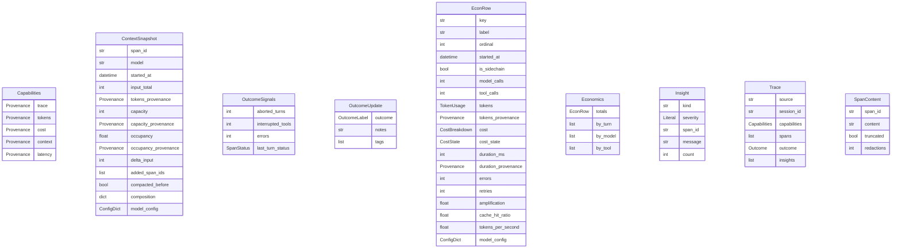
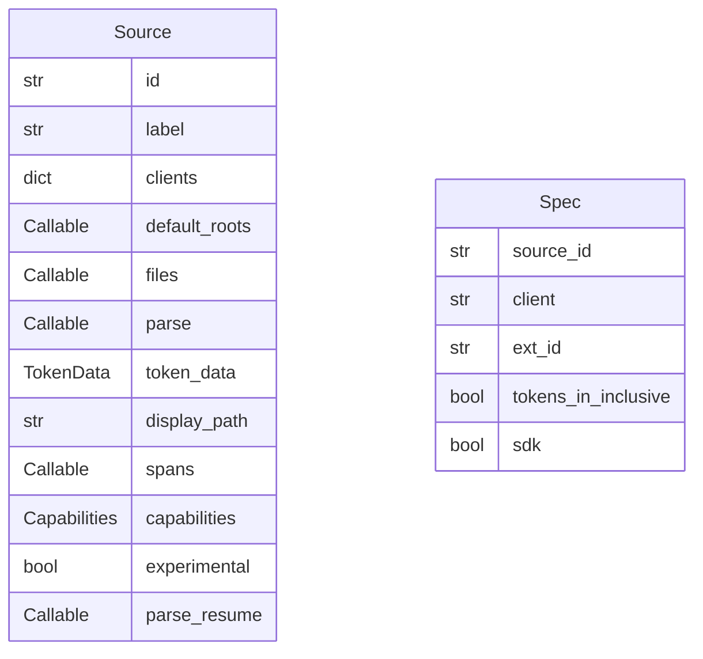
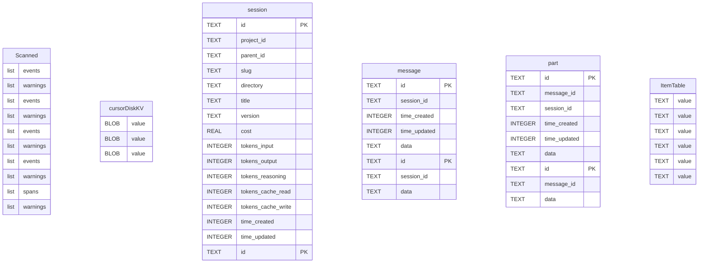
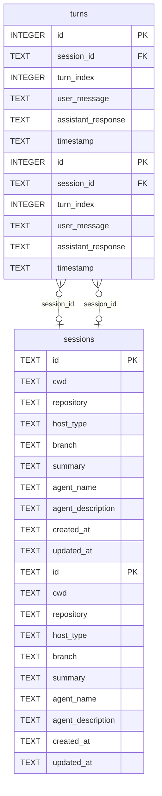
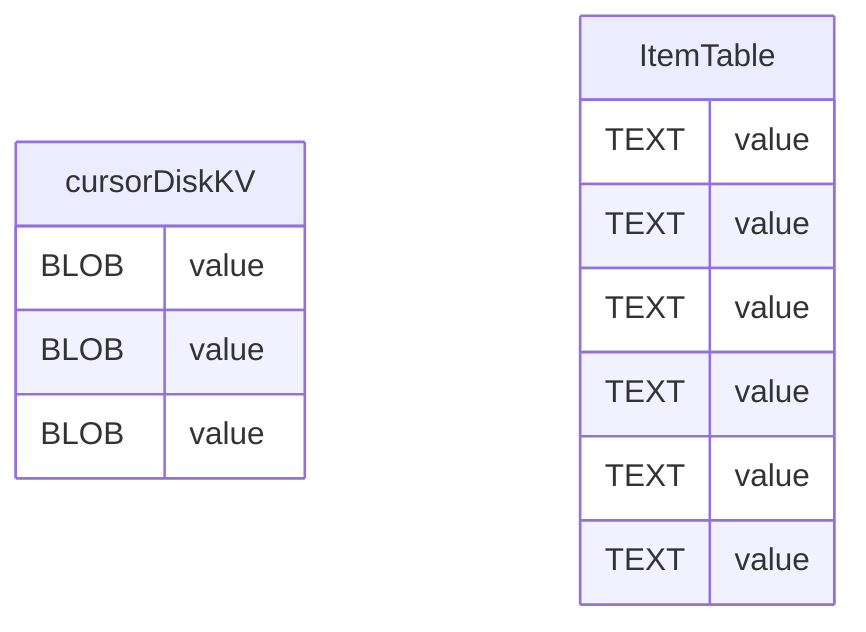
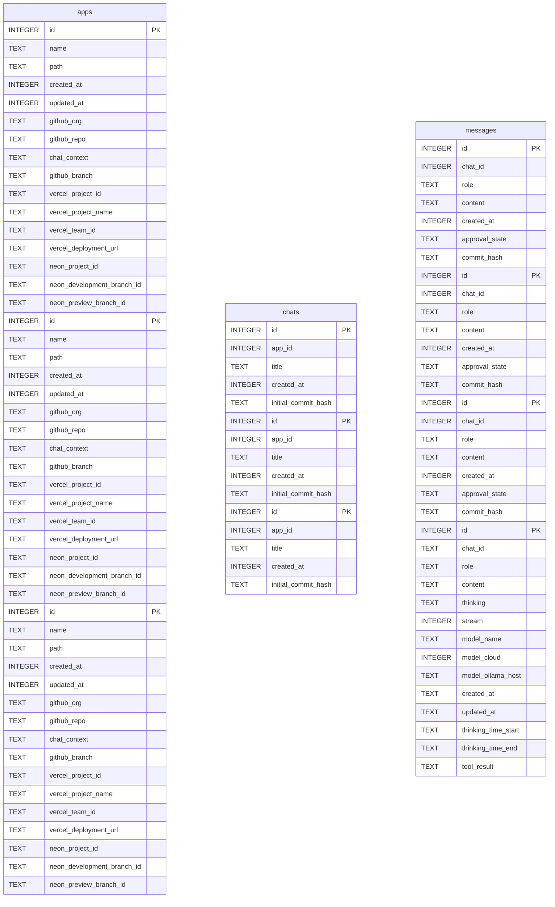
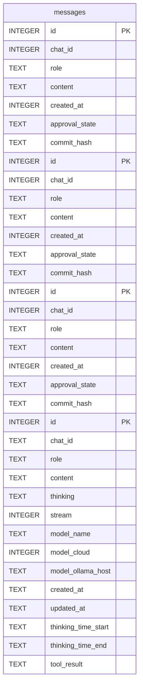
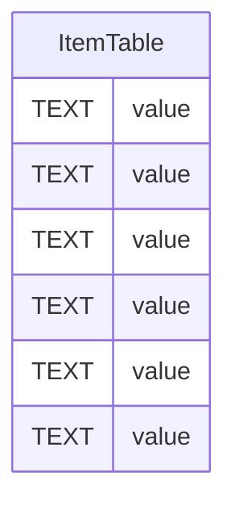

# ER Data Model

The data model drawn as entity relationship diagrams. Each entity is drawn in full in exactly one view.

## ER view: src/ai_usage_cost (1)

%% generated:diagram-er-src-ai-usage-cost-1 start (do not edit; run brain docs generate) %%

```mermaid
erDiagram
    Totals {
        TokenUsage tokens
        CostBreakdown cost
        float reported_cost
        int events
        int priced_events
        int sessions
        datetime first_event
        datetime last_event
    }
    SeriesPoint {
        date day
        str client
        str provider
        str model
        str source
        float cost
        int tokens
        int events
    }
    SessionRow {
        str session_id
        str source
        str client
        str provider
        list models
        datetime start_time
        datetime end_time
        int request_count
        TokenUsage tokens
        CostBreakdown cost
        float reported_cost
        CostState cost_state
        list cost_states
        bool is_sidechain
        bool has_sidechain
        str currency
        str project
        str working_directory
        str repository
        str branch
        str machine
        list raw_source
        OutcomeLabel outcome
        bool traced
        int error_count
        str title
    }
    UnknownModel {
        str model
        int tokens
        int events
    }
    WarningInstance {
        str kind
        str message
        str source
        str file
        str session_id
        WarningSeverity severity
        int delta_tokens
        float delta_cost
        str likely_cause
        bool auto_corrected
    }
    WarningGroup {
        str kind
        str label
        int count
        str summary
        WarningSeverity severity
        int total_delta_tokens
        float total_delta_cost
        WarningInstance worst_example
        int affected_sessions
        list instances
        list warnings
    }
    Facets {
        dict states
        dict clients
        dict models
        dict projects
        dict outcomes
    }
    Report {
        datetime generated_at
        str rates_as_of
        int rates_age_days
        str currency
        int files_scanned
        int files_in_slice
        Totals totals
        list by_client
        list by_provider
        list by_model
        list by_project
        list by_day
        list series
        list sessions
        list unknown_models
        list warnings
        list scan_warnings
        list warning_groups
        Facets facets
        dict model_matches
    }
    ClientInfo {
        str id
        str label
    }
    WarningSummary {
        int critical
        int caution
        int info
        float total_delta_cost
    }
    Meta {
        list clients
        list providers
        list models
        list projects
        date first_day
        date last_day
        str rates_as_of
        int rates_age_days
        str currency
        int files_scanned
        int events
        list warnings
        WarningSummary warning_summary
        dict session_warnings
        list sources
        dict client_last_seen
        dict model_last_seen
        dict project_last_seen
    }
    AlertDecision {
        bool fire
        str message
    }
    Sample {
        str machine
        datetime sampled_at
        float gpu_util
        int vram_used
        int vram_total
        float power_w
        str source
    }
    samples {
        TEXT machine
        TEXT sampled_at
        REAL gpu_util
        INTEGER vram_used
        INTEGER vram_total
        REAL power_w
        TEXT source
    }
    apps {
        INTEGER id PK
        TEXT name
        TEXT path
        INTEGER created_at
        INTEGER updated_at
        TEXT github_org
        TEXT github_repo
        TEXT chat_context
        TEXT github_branch
        TEXT vercel_project_id
        TEXT vercel_project_name
        TEXT vercel_team_id
        TEXT vercel_deployment_url
        TEXT neon_project_id
        TEXT neon_development_branch_id
        TEXT neon_preview_branch_id
    }
    chats {
        INTEGER id PK
        INTEGER app_id
        TEXT title
        INTEGER created_at
        TEXT initial_commit_hash
    }
    messages {
        INTEGER id PK
        INTEGER chat_id
        TEXT role
        TEXT content
        INTEGER created_at
        TEXT approval_state
        TEXT commit_hash
    }
    TokenUsage {
        int uncached_input
        int cache_read
        int cache_write_5m
        int cache_write_1h
        int output
        int reasoning_output
    }
    UsageEvent {
        str source
        str client
        str provider
        str model
        datetime timestamp
        str session_id
        str request_id
        TokenUsage tokens
        bool is_sidechain
        str tier
        str project
        str working_directory
        str repository
        str branch
        str title
        Literal title_source
        str machine
        str source_file
        int record_offset
        dict raw
        float reported_cost
    }
    CostBreakdown {
        float uncached_input
        float cache_read
        float cache_write
        float output
        float no_cache_equivalent
        bool estimated
        bool tier_unpriced
    }
    apps {
        INTEGER id PK
        TEXT name
        TEXT path
        INTEGER created_at
        INTEGER updated_at
        TEXT github_org
        TEXT github_repo
        TEXT chat_context
        TEXT github_branch
        TEXT vercel_project_id
        TEXT vercel_project_name
        TEXT vercel_team_id
        TEXT vercel_deployment_url
        TEXT neon_project_id
        TEXT neon_development_branch_id
        TEXT neon_preview_branch_id
    }
    chats {
        INTEGER id PK
        INTEGER app_id
        TEXT title
        INTEGER created_at
        TEXT initial_commit_hash
    }
    messages {
        INTEGER id PK
        INTEGER chat_id
        TEXT role
        TEXT content
        INTEGER created_at
        TEXT approval_state
        TEXT commit_hash
    }
    apps {
        INTEGER id PK
        TEXT name
        TEXT path
        INTEGER created_at
        INTEGER updated_at
        TEXT github_org
        TEXT github_repo
        TEXT chat_context
        TEXT github_branch
        TEXT vercel_project_id
        TEXT vercel_project_name
        TEXT vercel_team_id
        TEXT vercel_deployment_url
        TEXT neon_project_id
        TEXT neon_development_branch_id
        TEXT neon_preview_branch_id
    }
    chats {
        INTEGER id PK
        INTEGER app_id
        TEXT title
        INTEGER created_at
        TEXT initial_commit_hash
    }
    messages {
        INTEGER id PK
        INTEGER chat_id
        TEXT role
        TEXT content
        INTEGER created_at
        TEXT approval_state
        TEXT commit_hash
    }
    messages {
        INTEGER id PK
        TEXT chat_id
        TEXT role
        TEXT content
        TEXT thinking
        INTEGER stream
        TEXT model_name
        INTEGER model_cloud
        TEXT model_ollama_host
        TEXT created_at
        TEXT updated_at
        TEXT thinking_time_start
        TEXT thinking_time_end
        TEXT tool_result
    }
```

%% generated:diagram-er-src-ai-usage-cost-1 end %%

<<<<<<< HEAD
<<<<<<< HEAD
=======
=======
>>>>>>> docs/chunk-ch-localtokenomics-web-src-components-ui
%% generated:diagram-er-src-ai-usage-cost-1-nodes start (do not edit; run brain docs generate) %%
### Node citations

- AlertDecision: `src/ai_usage_cost/cli.py:252-254`
- ClientInfo: `src/ai_usage_cost/api.py:86-88`
- CostBreakdown: `src/ai_usage_cost/models.py:75-114`
- Facets: `src/ai_usage_cost/aggregate.py:454-459`
- Meta: `src/ai_usage_cost/api.py:105-128`
- Report: `src/ai_usage_cost/aggregate.py:462-482`
- Sample: `src/ai_usage_cost/collect.py:49-56`
- SeriesPoint: `src/ai_usage_cost/aggregate.py:37-45`
- SessionRow: `src/ai_usage_cost/aggregate.py:48-74`
- TokenUsage: `src/ai_usage_cost/models.py:12-43`
- Totals: `src/ai_usage_cost/aggregate.py:26-34`
- UnknownModel: `src/ai_usage_cost/aggregate.py:77-80`
- UsageEvent: `src/ai_usage_cost/models.py:49-72`
- WarningGroup: `src/ai_usage_cost/aggregate.py:115-127`
- WarningInstance: `src/ai_usage_cost/aggregate.py:100-111`
- WarningSummary: `src/ai_usage_cost/api.py:91-102`
- apps: `tests/fixtures/dyad/null_title.sql:1-18`
- chats: `tests/fixtures/dyad/null_title.sql:20-26`
- messages: `tests/fixtures/ollama_app/basic.sql:1-16`
- samples: `src/ai_usage_cost/collect.py:19-23`
%% generated:diagram-er-src-ai-usage-cost-1-nodes end %%
<<<<<<< HEAD
>>>>>>> docs/chunk-ch-localtokenomics-web-src
=======
>>>>>>> docs/chunk-ch-localtokenomics-web-src-components-ui

## ER view: src/ai_usage_cost (2)

%% generated:diagram-er-src-ai-usage-cost-2 start (do not edit; run brain docs generate) %%

```mermaid
erDiagram
    PricedEvent {
        UsageEvent event
        CostBreakdown cost
        CostState state
    }
    Bucket {
        str key
        str label
        TokenUsage tokens
        CostBreakdown cost
        int events
        int sessions
        float reported_cost
    }
    SourceInfo {
        str id
        str label
        list clients
        TokenData token_data
        str path
        str root_hint
        bool detected
        int files
        Capabilities capabilities
        bool experimental
    }
    Analysis {
        list events
        RateTable table
        int files
        list warnings
        list scan_warnings
        list sources
        dict session_flags
        Path db_path
        date today
    }
    PriceSet {
        float input
        float output
        float cache_read
        float cache_write_5m
        float cache_write_1h
    }
    Period {
        ConfigDict model_config
        date from_
        date until
        float input
        float output
        float cache_read
        float cache_write_5m
        float cache_write_1h
        dict variants
        list bands
        Peak peak
    }
    ProviderRules {
        float cache_read
        float cache_write_5m
        float cache_write_1h
        float batch
        bool free
    }
    PartialRules {
        float cache_read
        float cache_write_5m
        float cache_write_1h
        float batch
        bool free
    }
    Prefix {
        str prefix
        str provider
    }
    ModelMatch {
        str match
        Literal kind
    }
    UnpricedModel {
        str match
        str note
        Literal status
    }
    RateTable {
        str as_of
        str currency
        str units
        list notes
        list prefixes
        dict providers
        list models
        list unpriced_models
        dict _lookup_cache
        dict _rules_cache
        list _prefix_cache
    }
    Config {
        bool metadata_only
        list exclude_projects
        int max_content_bytes
        int metadata_retention_days
        int content_retention_days
    }
    IngestSummary {
        int files_parsed
        int files_skipped
        list warnings
    }
    requests {
        TEXT fingerprint PK
        TEXT source
        TEXT client
        TEXT provider
        TEXT model
        TEXT session_id
        TEXT timestamp
        TEXT request_id
        INTEGER uncached_input
        INTEGER cache_read
        INTEGER cache_write_5m
        INTEGER cache_write_1h
        INTEGER output
        INTEGER reasoning_output
        INTEGER is_sidechain
        TEXT tier
        TEXT project
        TEXT working_directory
        TEXT repository
        TEXT branch
        TEXT machine
        TEXT source_file
        TEXT raw
        TEXT title
        TEXT title_source
        REAL reported_cost
    }
    files {
        TEXT path PK
        TEXT source
        REAL mtime
        INTEGER size
        TEXT ingested_at
        TEXT warnings
        INTEGER parser_version
        INTEGER ingested_offset
        TEXT boundary_hash
        TEXT title_seed
    }
    trace_events {
        TEXT span_id PK
        TEXT parent_id
        TEXT record_parent
        TEXT source
        TEXT session_id
        TEXT turn_id
        TEXT agent_id
        INTEGER is_sidechain
        INTEGER seq
        TEXT kind
        TEXT name
        TEXT model
        TEXT status
        TEXT started_at
        TEXT ended_at
        INTEGER duration_ms
        TEXT duration_provenance
        INTEGER ttft_ms
        INTEGER uncached_input
        INTEGER cache_read
        INTEGER cache_write_5m
        INTEGER cache_write_1h
        INTEGER output
        INTEGER reasoning_output
        TEXT tokens_provenance
        INTEGER context_capacity
        TEXT capacity_provenance
        INTEGER retry_attempt
        TEXT error
        TEXT source_file
        INTEGER record_offset
        INTEGER record_length
        TEXT content_path
        TEXT detail
    }
    outcomes {
        TEXT source PK
        TEXT session_id PK
        TEXT outcome
        TEXT notes
        TEXT tags
        TEXT updated_at
    }
    session_exclusions {
        TEXT source PK
        TEXT session_id PK
        TEXT excluded_at
    }
    Span {
        ConfigDict model_config
        str span_id
        str parent_id
        str record_parent
        str source
        str session_id
        str turn_id
        str agent_id
        bool is_sidechain
        int seq
        SpanKind kind
        str name
        str model
        SpanStatus status
        datetime started_at
        datetime ended_at
        int duration_ms
        Provenance duration_provenance
        int ttft_ms
        TokenUsage tokens
        Provenance tokens_provenance
        int context_capacity
        Provenance capacity_provenance
        int retry_attempt
        str error
        str source_file
        int record_offset
        int record_length
        str content_path
        dict detail
    }
```

%% generated:diagram-er-src-ai-usage-cost-2 end %%

<<<<<<< HEAD
<<<<<<< HEAD
=======
=======
>>>>>>> docs/chunk-ch-localtokenomics-web-src-components-ui
%% generated:diagram-er-src-ai-usage-cost-2-nodes start (do not edit; run brain docs generate) %%
### Node citations

- Analysis: `src/ai_usage_cost/pipeline.py:45-63`
- Bucket: `src/ai_usage_cost/models.py:123-134`
- Config: `src/ai_usage_cost/privacy.py:52-57`
- IngestSummary: `src/ai_usage_cost/store.py:134-137`
- ModelMatch: `src/ai_usage_cost/pricing.py:224-229`
- PartialRules: `src/ai_usage_cost/pricing.py:109-117`
- Period: `src/ai_usage_cost/pricing.py:68-98`
- Prefix: `src/ai_usage_cost/pricing.py:169-171`
- PriceSet: `src/ai_usage_cost/pricing.py:29-37`
- PricedEvent: `src/ai_usage_cost/models.py:117-120`
- ProviderRules: `src/ai_usage_cost/pricing.py:101-106`
- RateTable: `src/ai_usage_cost/pricing.py:252-372`
- SourceInfo: `src/ai_usage_cost/pipeline.py:31-41`
- Span: `src/ai_usage_cost/trace.py:55-101`
- UnpricedModel: `src/ai_usage_cost/pricing.py:232-242`
- files: `src/ai_usage_cost/store.py:36-82`
- outcomes: `src/ai_usage_cost/store.py:63-68`
- requests: `src/ai_usage_cost/store.py:23-85`
- session_exclusions: `src/ai_usage_cost/store.py:69-72`
- trace_events: `src/ai_usage_cost/store.py:43-60`
%% generated:diagram-er-src-ai-usage-cost-2-nodes end %%
<<<<<<< HEAD
>>>>>>> docs/chunk-ch-localtokenomics-web-src
=======
>>>>>>> docs/chunk-ch-localtokenomics-web-src-components-ui

## ER view: src/ai_usage_cost (3)

%% generated:diagram-er-src-ai-usage-cost-3 start (do not edit; run brain docs generate) %%

%% generated:diagram-er-src-ai-usage-cost-3 end %%

<<<<<<< HEAD
<<<<<<< HEAD
=======
=======
>>>>>>> docs/chunk-ch-localtokenomics-web-src-components-ui
%% generated:diagram-er-src-ai-usage-cost-3-nodes start (do not edit; run brain docs generate) %%
### Node citations

- Capabilities: `src/ai_usage_cost/trace.py:104-109`
- ContextSnapshot: `src/ai_usage_cost/trace.py:112-131`
- EconRow: `src/ai_usage_cost/trace.py:154-174`
- Economics: `src/ai_usage_cost/trace.py:177-181`
- Insight: `src/ai_usage_cost/trace.py:184-189`
- OutcomeSignals: `src/ai_usage_cost/trace.py:134-138`
- OutcomeUpdate: `src/ai_usage_cost/trace.py:141-144`
- SpanContent: `src/ai_usage_cost/trace.py:201-205`
- Trace: `src/ai_usage_cost/trace.py:192-198`
%% generated:diagram-er-src-ai-usage-cost-3-nodes end %%
<<<<<<< HEAD
>>>>>>> docs/chunk-ch-localtokenomics-web-src
=======
>>>>>>> docs/chunk-ch-localtokenomics-web-src-components-ui

## ER view: src/ai_usage_cost/sources

%% generated:diagram-er-src-ai-usage-cost-sources start (do not edit; run brain docs generate) %%

%% generated:diagram-er-src-ai-usage-cost-sources end %%

<<<<<<< HEAD
<<<<<<< HEAD
=======
=======
>>>>>>> docs/chunk-ch-localtokenomics-web-src-components-ui
%% generated:diagram-er-src-ai-usage-cost-sources-nodes start (do not edit; run brain docs generate) %%
### Node citations

- Source: `src/ai_usage_cost/sources/base.py:18-44`
- Spec: `src/ai_usage_cost/sources/cline.py:82-87`
%% generated:diagram-er-src-ai-usage-cost-sources-nodes end %%
<<<<<<< HEAD
>>>>>>> docs/chunk-ch-localtokenomics-web-src
=======
>>>>>>> docs/chunk-ch-localtokenomics-web-src-components-ui

## ER view: tests

%% generated:diagram-er-tests start (do not edit; run brain docs generate) %%

%% generated:diagram-er-tests end %%

<<<<<<< HEAD
<<<<<<< HEAD
=======
=======
>>>>>>> docs/chunk-ch-localtokenomics-web-src-components-ui
%% generated:diagram-er-tests-nodes start (do not edit; run brain docs generate) %%
### Node citations

- ItemTable: `tests/fixtures/windsurf/no_chat_key.sql:1`
- Scanned: `tests/test_trace_codex.py:28-36`
- cursorDiskKV: `tests/fixtures/cursor/empty.sql:1`
- message: `tests/test_opencode.py:318`
- part: `tests/test_opencode.py:319`
- session: `tests/test_opencode.py:317`
%% generated:diagram-er-tests-nodes end %%
<<<<<<< HEAD
>>>>>>> docs/chunk-ch-localtokenomics-web-src
=======
>>>>>>> docs/chunk-ch-localtokenomics-web-src-components-ui

## ER view: tests/fixtures/copilot_chat

%% generated:diagram-er-tests-fixtures-copilot-chat start (do not edit; run brain docs generate) %%

%% generated:diagram-er-tests-fixtures-copilot-chat end %%

<<<<<<< HEAD
<<<<<<< HEAD
=======
=======
>>>>>>> docs/chunk-ch-localtokenomics-web-src-components-ui
%% generated:diagram-er-tests-fixtures-copilot-chat-nodes start (do not edit; run brain docs generate) %%
### Node citations

- sessions: `tests/fixtures/copilot_chat/empty.sql:1-12`
- turns: `tests/fixtures/copilot_chat/empty.sql:14-21`
%% generated:diagram-er-tests-fixtures-copilot-chat-nodes end %%
<<<<<<< HEAD
>>>>>>> docs/chunk-ch-localtokenomics-web-src
=======
>>>>>>> docs/chunk-ch-localtokenomics-web-src-components-ui

## ER view: tests/fixtures/cursor

%% generated:diagram-er-tests-fixtures-cursor start (do not edit; run brain docs generate) %%

%% generated:diagram-er-tests-fixtures-cursor end %%

<<<<<<< HEAD
<<<<<<< HEAD
=======
=======
>>>>>>> docs/chunk-ch-localtokenomics-web-src-components-ui
%% generated:diagram-er-tests-fixtures-cursor-nodes start (do not edit; run brain docs generate) %%
### Node citations

- ItemTable: `tests/fixtures/windsurf/no_chat_key.sql:1`
- cursorDiskKV: `tests/fixtures/cursor/empty.sql:1`
%% generated:diagram-er-tests-fixtures-cursor-nodes end %%
<<<<<<< HEAD
>>>>>>> docs/chunk-ch-localtokenomics-web-src
=======
>>>>>>> docs/chunk-ch-localtokenomics-web-src-components-ui

## ER view: tests/fixtures/dyad

%% generated:diagram-er-tests-fixtures-dyad start (do not edit; run brain docs generate) %%

%% generated:diagram-er-tests-fixtures-dyad end %%

<<<<<<< HEAD
<<<<<<< HEAD
=======
=======
>>>>>>> docs/chunk-ch-localtokenomics-web-src-components-ui
%% generated:diagram-er-tests-fixtures-dyad-nodes start (do not edit; run brain docs generate) %%
### Node citations

- apps: `tests/fixtures/dyad/null_title.sql:1-18`
- chats: `tests/fixtures/dyad/null_title.sql:20-26`
- messages: `tests/fixtures/ollama_app/basic.sql:1-16`
%% generated:diagram-er-tests-fixtures-dyad-nodes end %%
<<<<<<< HEAD
>>>>>>> docs/chunk-ch-localtokenomics-web-src
=======
>>>>>>> docs/chunk-ch-localtokenomics-web-src-components-ui

## ER view: tests/fixtures/ollama_app

%% generated:diagram-er-tests-fixtures-ollama-app start (do not edit; run brain docs generate) %%

%% generated:diagram-er-tests-fixtures-ollama-app end %%

<<<<<<< HEAD
<<<<<<< HEAD
=======
=======
>>>>>>> docs/chunk-ch-localtokenomics-web-src-components-ui
%% generated:diagram-er-tests-fixtures-ollama-app-nodes start (do not edit; run brain docs generate) %%
### Node citations

- messages: `tests/fixtures/ollama_app/basic.sql:1-16`
%% generated:diagram-er-tests-fixtures-ollama-app-nodes end %%
<<<<<<< HEAD
>>>>>>> docs/chunk-ch-localtokenomics-web-src
=======
>>>>>>> docs/chunk-ch-localtokenomics-web-src-components-ui

## ER view: tests/fixtures/windsurf

%% generated:diagram-er-tests-fixtures-windsurf start (do not edit; run brain docs generate) %%

%% generated:diagram-er-tests-fixtures-windsurf end %%

<<<<<<< HEAD
<<<<<<< HEAD
=======
=======
>>>>>>> docs/chunk-ch-localtokenomics-web-src-components-ui
%% generated:diagram-er-tests-fixtures-windsurf-nodes start (do not edit; run brain docs generate) %%
### Node citations

- ItemTable: `tests/fixtures/windsurf/no_chat_key.sql:1`
%% generated:diagram-er-tests-fixtures-windsurf-nodes end %%
<<<<<<< HEAD
>>>>>>> docs/chunk-ch-localtokenomics-web-src
=======
>>>>>>> docs/chunk-ch-localtokenomics-web-src-components-ui
