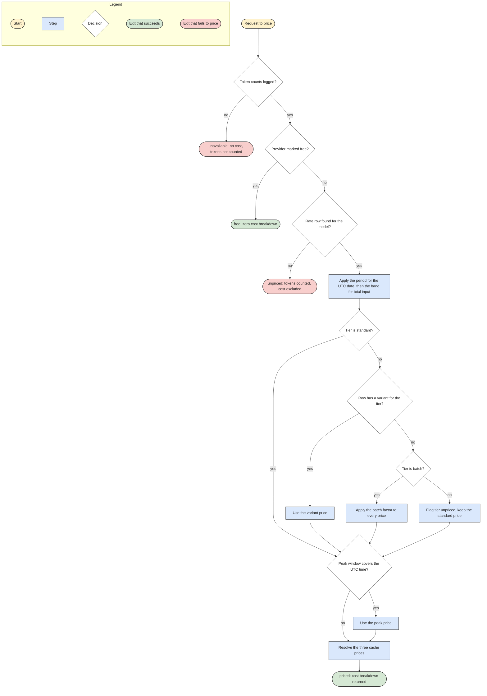

# How one request is priced

This view lays out how the tool decides the price of one request. It shows the early exits where a request is left unpriced and the order in which the date, the size, the service tier and the time of day change the rate. Anyone checking a number on a report can follow the same steps.

## What the diagram shows

- A request with no token counts leaves the flow as unavailable. `src/ai_usage_cost/pricing.py:420`
- A free provider leaves the flow as free with a zero breakdown. `src/ai_usage_cost/pricing.py:422`
- A model with no rate row leaves the flow as unpriced. `src/ai_usage_cost/pricing.py:424`
- The price fields of the first period that covers the UTC date replace the row's own. `src/ai_usage_cost/pricing.py:505`
- The last band whose minimum is at or under the request's total input is selected. `src/ai_usage_cost/pricing.py:508`
- A tier other than standard uses the row's variant for that tier when one exists. `src/ai_usage_cost/pricing.py:520`
- Without a variant a batch request gets the batch factor on every price. `src/ai_usage_cost/pricing.py:523`
- Any other tier is flagged as unpriced for that tier and keeps the standard price. `src/ai_usage_cost/pricing.py:526`
- A peak window that covers the UTC weekday and hour replaces the price. `src/ai_usage_cost/pricing.py:528`
- Each cache price is the set's own figure, else the row's published ratio, else the provider multiplier. `src/ai_usage_cost/pricing.py:478`
- The result is a cost breakdown that also keeps a no cache baseline. `src/ai_usage_cost/pricing.py:559`

## Capability and related functionality

- Realises the pricing rule behind every cost figure in [[Ai usage cost Overview]].
- The three early exits are the states drawn in [[Cost state of a request]].
- The run that calls this step for every request is [[Scan pipeline from logs to report]].
- The rate table fields it reads are listed in [[Ai usage cost Data Model]].

## The diagram

%% generated:diagram-flow-price-one-request start (do not edit; run brain docs generate) %%

%% generated:diagram-flow-price-one-request end %%

> [!example]- Code references
> | Code | What it shows |
> |---|---|
> | `src/ai_usage_cost/pricing.py:495` | Period, band, tier, peak and cache price resolution |
> | `src/ai_usage_cost/pricing.py:429` | The early exits and the call to cost of |
> | `src/ai_usage_cost/pricing.py:446` | How a period replaces the row's prices |
> | `src/ai_usage_cost/pricing.py:478` | The three step cache price rule |
