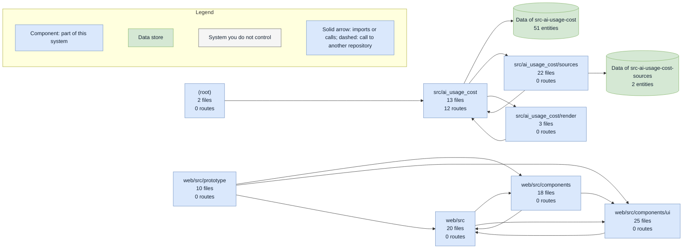
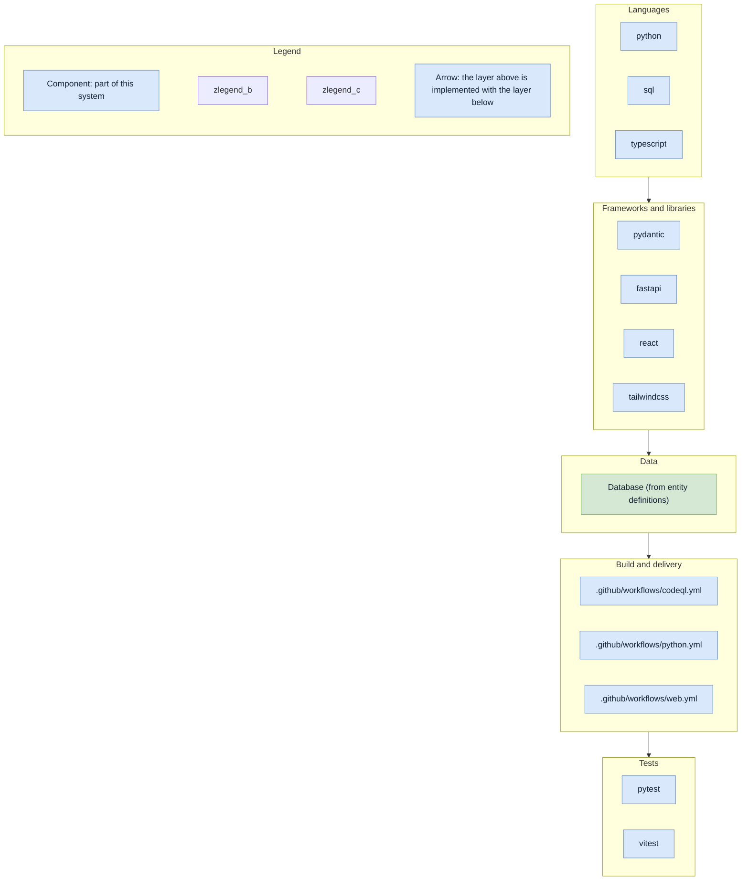

# Layered Viewpoints

Two layered views derived from the code: how components communicate, and the technology each layer rests on.

## Application communication

%% generated:diagram-application-communication start (do not edit; run brain docs generate) %%

%% generated:diagram-application-communication end %%

## Technology landscape

%% generated:diagram-technology-landscape start (do not edit; run brain docs generate) %%

%% generated:diagram-technology-landscape end %%
