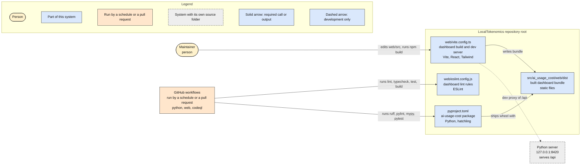

# LocalTokenomics root wiring

This view shows how the top level files of the project fit together. It explains how the dashboard is built, where the finished files end up, and which automatic checks guard both halves. A maintainer can use it to see what to change, and what to run, before touching the dashboard or the package.

## What the diagram shows

The maintainer edits the dashboard source and runs the build script from the web folder. `web/package.json:6-13`

The build configuration writes the finished dashboard into a folder inside the Python package. `web/vite.config.ts:14-17`

The package metadata builds the installable wheel from that same package folder, so the finished dashboard is shipped with it. `pyproject.toml:32-37`

During development the dashboard dev server forwards every request that starts with `/api` to the Python server on port 8420. `web/vite.config.ts:18-26`

The dashboard lint rules apply to the dashboard TypeScript files and skip the built folder. `web/eslint.config.js:8-11`

The Python workflow runs on a pull request and a push to the main branch. It runs ruff, pylint, mypy and pytest. `.github/workflows/python.yml:3-6` `.github/workflows/python.yml:41-54`

The web workflow runs on the same triggers and runs lint, type check, test and build. `.github/workflows/web.yml:3-6` `.github/workflows/web.yml:36-46`

## Capability and related functionality

The diagram realises the build and quality capability of the repository root. It serves the maintainer, not the person who only installs the tool. The files it shows are explained in [[localtokenomics root Overview]] and [[localtokenomics root Operations]], and the dashboard tests are in [[localtokenomics root Tests]]. The generated module map for the same chunk is in [[localtokenomics root Diagrams]].

## LocalTokenomics root wiring

%% generated:diagram-c4-localtokenomics-root-wiring start (do not edit; run brain docs generate) %%

%% generated:diagram-c4-localtokenomics-root-wiring end %%

> [!example]- Code references
> | Code | What it shows |
> |---|---|
> | `web/vite.config.ts:14-17` | Build output folder inside the Python package |
> | `web/vite.config.ts:18-26` | Dev server port and the `/api` proxy |
> | `web/eslint.config.js:7-25` | Lint rules and ignored folders |
> | `web/package.json:6-13` | Dashboard scripts the maintainer and the web workflow run |
> | `pyproject.toml:29-37` | Console script and wheel contents |
> | `.github/workflows/python.yml:3-54` | Python checks |
> | `.github/workflows/web.yml:3-46` | Web checks |
