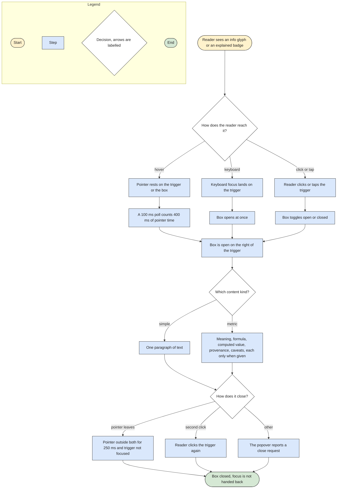

# Metric info interaction flow

This flow shows how a reader gets an explanation for a number or a badge. The box opens by hover, keyboard focus or tap, and it closes without stealing focus. This matters because almost every figure on the dashboard hangs an explanation on this one component.

## What the diagram shows

The info glyph is a small letter i drawn next to a label, and the stat card wraps it in the info box when it has an explanation. `web/src/components/metric-info.tsx:193-205` `web/src/components/stat.tsx:101-103`

One listener on the page records the last pointer position for every info box. `web/src/components/metric-info.tsx:35-42`

Each box checks that position every 100 ms, and when the pointer has stayed on the trigger or on the box for 400 ms it opens. `web/src/components/metric-info.tsx:11-13` `web/src/components/metric-info.tsx:88-94`

Keyboard focus on the trigger opens the box at once, and a click or tap toggles it. `web/src/components/metric-info.tsx:134-136` `web/src/components/metric-info.tsx:141-143`

The box opens on the right of the trigger and moves away from the screen edge when it would not fit. `web/src/components/metric-info.tsx:151-155`

A simple box shows one paragraph, and a metric box shows the meaning and then the formula, computed value, provenance and caveats that were supplied. `web/src/components/metric-info.tsx:165-165` `web/src/components/metric-info.tsx:168-183`

The box closes when the pointer has been outside both the trigger and the box for 250 ms and the trigger is not focused. `web/src/components/metric-info.tsx:100-107`

Any other close request from the popover resets the focus flag and the timer. `web/src/components/metric-info.tsx:116-123`

The box never hands focus back to the trigger when it closes, because the focus handler of the trigger would reopen it at once. `web/src/components/metric-info.tsx:162-162`

A test opens the box by click and checks the text. `web/src/components/metric-info.test.tsx:7-7`

## Capability and related functionality

The flow realises the on demand explanation of metrics and badges. The component is drawn in [[Shared components C4]] and [[Dashboard component composition]]. Its tests are in [[Web UI components Tests]]. Its popover comes from [[Web ui UI components Overview]]. The page level screens that use it are described in [[Web Overview]].

## Metric info interaction flow

%% generated:diagram-metric-info-interaction start (do not edit; run brain docs generate) %%

%% generated:diagram-metric-info-interaction end %%

> [!example]- Code references
> | Code | What it shows |
> |---|---|
> | `web/src/components/metric-info.tsx:35-42` | Shared pointer listener |
> | `web/src/components/metric-info.tsx:11-13` | Timing constants |
> | `web/src/components/metric-info.tsx:88-94` | Open after 400 ms |
> | `web/src/components/metric-info.tsx:134-136` | Open on focus |
> | `web/src/components/metric-info.tsx:141-143` | Toggle on click |
> | `web/src/components/metric-info.tsx:151-155` | Popover placement |
> | `web/src/components/metric-info.tsx:100-107` | Close after 250 ms outside |
> | `web/src/components/metric-info.tsx:162-162` | No focus return |
> | `web/src/components/metric-info.test.tsx:7-7` | Click test |
