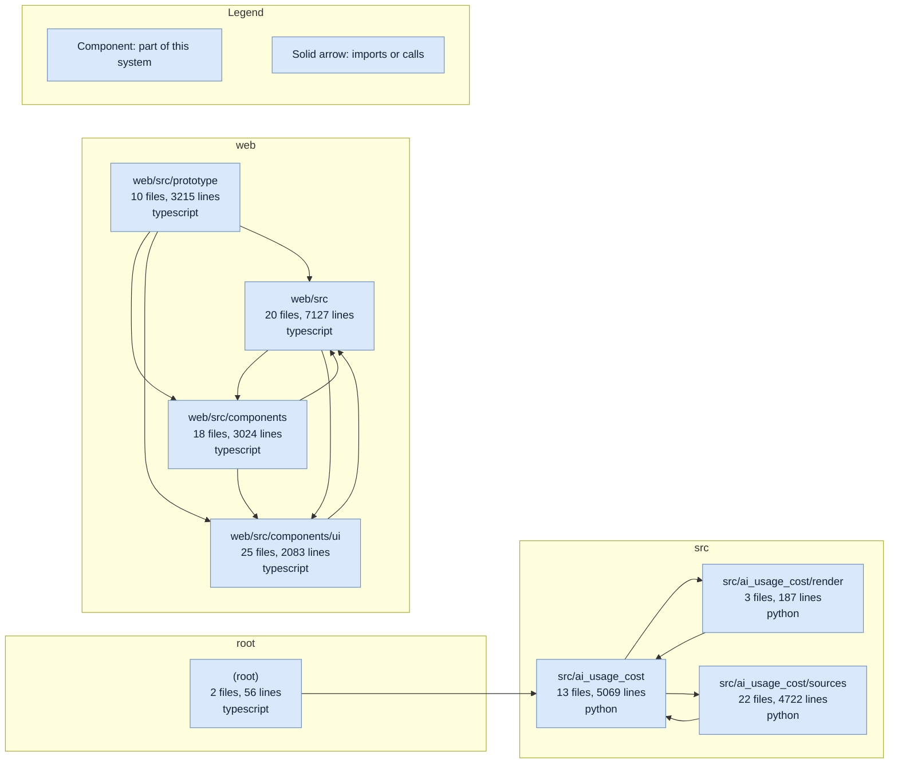

# Module Map Diagrams

Components and their dependencies, extracted from imports.

## Module dependency map

%% generated:diagram-module-map start (do not edit; run brain docs generate) %%

%% generated:diagram-module-map end %%

%% generated:node-citations-module-map start (do not edit; run brain docs generate) %%
### Node citations

- (root): `web/eslint.config.js:1-25`, `web/vite.config.ts:1-31`
- src/ai_usage_cost: `src/ai_usage_cost/__init__.py:1`, `src/ai_usage_cost/aggregate.py:1-723`, `src/ai_usage_cost/api.py:1-404`
- src/ai_usage_cost/render: `src/ai_usage_cost/render/__init__.py:1`, `src/ai_usage_cost/render/png.py:1-101`, `src/ai_usage_cost/render/terminal.py:1-86`
- src/ai_usage_cost/sources: `src/ai_usage_cost/sources/__init__.py:1-27`, `src/ai_usage_cost/sources/antigravity.py:1-314`, `src/ai_usage_cost/sources/base.py:1-176`
- web/src: `web/src/App.tsx:1-357`, `web/src/ContextTab.tsx:1-227`, `web/src/EconomicsTab.tsx:1-770`
- web/src/components: `web/src/components/chart-hover.tsx:1-121`, `web/src/components/chart-time.tsx:1-184`, `web/src/components/columns.tsx:1-95`
- web/src/components/ui: `web/src/components/ui/accordion.tsx:1-65`, `web/src/components/ui/alert.tsx:1-65`, `web/src/components/ui/badge.tsx:1-47`
- web/src/prototype: `web/src/prototype/Gallery.tsx:1-659`, `web/src/prototype/OverviewScreen.tsx:1-386`, `web/src/prototype/PricingScreen.tsx:1-218`
%% generated:node-citations-module-map end %%
