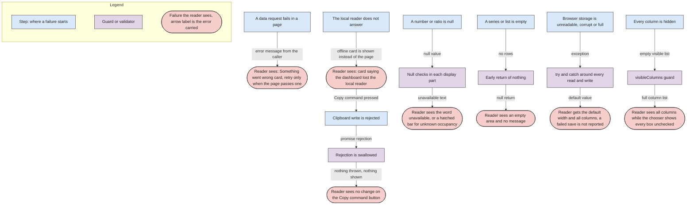

# Offline and error handling flow

This view shows what the reader sees when something goes wrong in the shared dashboard parts. Most failures turn into plain text, but three of them end in a silent or confusing result. Knowing this helps a developer decide where a message is still missing.

## What the diagram shows

When the app has an error message that is not the offline one, it draws the error card with no retry function, so the card shows the title and the message and no button. `web/src/App.tsx:274-274` `web/src/components/states.tsx:98-121`

The error card shows a retry button only when a retry function is passed in. `web/src/components/states.tsx:114-114`

The app decides that the reader is offline by looking for a fixed sentence inside the error text, and then draws the offline card in place of the page. `web/src/App.tsx:251-251`

The offline card says that the dashboard lost the local reader and offers Retry connection, which calls the retry function of the page. `web/src/components/states.tsx:311-311` `web/src/components/states.tsx:319-319`

Copy command writes the start command to the clipboard and swallows a rejection, so a failed copy leaves the button label unchanged. `web/src/components/states.tsx:294-300` `web/src/components/states.tsx:321-321`

Every display part that can receive a missing value checks for null and draws the word unavailable instead: the token cell, the meters, the bucket bar, the meter row and the comparison meter. `web/src/components/session.tsx:63-66` `web/src/components/status.tsx:253-256` `web/src/components/status.tsx:296-299` `web/src/components/status.tsx:383-385` `web/src/components/status.tsx:422-427`

A context bar with unknown occupancy is drawn as a hatched full height bar, and a note says that the client logged no capacity. `web/src/components/trace.tsx:136-144` `web/src/components/trace.tsx:106-106`

The time chart, the sparkline and the occupancy bars return nothing when they have no data, so the page shows an empty area unless it adds its own empty card. `web/src/components/chart-time.tsx:95-95` `web/src/components/sparkline.tsx:114-114` `web/src/components/trace.tsx:60-60`

Reads of the saved panel width and the hidden columns fall back to a default when the browser storage throws or holds a bad value, and the writes ignore a failure. `web/src/components/workspace-panel.ts:15-23` `web/src/components/workspace-panel.ts:25-31` `web/src/components/columns.tsx:22-31` `web/src/components/columns.tsx:33-39`

When every column is hidden, the table shows all of them, while the chooser still draws each box as unchecked. `web/src/components/columns.tsx:59-59` `web/src/components/columns.tsx:85-85`

## Capability and related functionality

The flow covers the failure behaviour of the shared display layer. The offline and error cards are drawn in [[Shared components C4]] and [[Offline card screen map]]. The warnings list has its own states in [[Warnings list states]]. The written explanation is in [[Web UI components Overview]]. The pages that supply the messages are in [[Web Overview]].

## Offline and error handling flow

%% generated:diagram-offline-and-error-handling start (do not edit; run brain docs generate) %%

%% generated:diagram-offline-and-error-handling end %%

> [!example]- Code references
> | Code | What it shows |
> |---|---|
> | `web/src/components/states.tsx:98-121` | Error card |
> | `web/src/App.tsx:274-274` | App draws the error card |
> | `web/src/App.tsx:251-251` | Offline detection by message text |
> | `web/src/components/states.tsx:311-311` | Offline card text |
> | `web/src/components/states.tsx:294-300` | Clipboard write |
> | `web/src/components/status.tsx:296-299` | Bucket bar without counts |
> | `web/src/components/trace.tsx:106-106` | Unknown occupancy note |
> | `web/src/components/chart-time.tsx:95-95` | Empty time chart |
> | `web/src/components/columns.tsx:33-39` | Hidden column write |
> | `web/src/components/columns.tsx:59-59` | All columns hidden |
