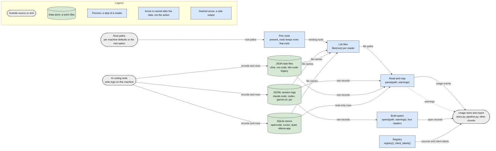

# Reader data lineage

This diagram follows the data from the files AI coding tools leave on a machine to the records the rest of the product uses. It shows where each data set is only read, where it is turned into something new and where warnings travel. A reader of the diagram can tell at once that no tool file is ever changed.

## What the diagram shows

- The tools write JSON line logs, JSON task files and SQLite stores. The readers only read them. `src/ai_usage_cost/sources/claude_code.py:677` `src/ai_usage_cost/sources/cline.py:424` `src/ai_usage_cost/sources/base.py:123`
- Root paths come from each reader's default roots or from a root the user passes, and only roots that exist are kept. `src/ai_usage_cost/sources/base.py:47` `src/ai_usage_cost/sources/base.py:49`
- For every kept root the reader's files function lists the files to read. `src/ai_usage_cost/store.py:220`
- The ingest loop calls the reader's parse function for each file and passes it a warnings list. `src/ai_usage_cost/store.py:255`
- Four readers also provide a spans function, which reads the same log again to build span records. `src/ai_usage_cost/sources/claude_code.py:681` `src/ai_usage_cost/sources/codex.py:954` `src/ai_usage_cost/sources/qwen_code.py:172` `src/ai_usage_cost/sources/antigravity.py:306`
- The JSON line helpers count lines that fail to parse and add one warning per file, and the SQLite helper turns a database error into a warning. `src/ai_usage_cost/sources/base.py:84` `src/ai_usage_cost/sources/base.py:128`
- Usage events, span records and warnings leave the chunk to the store, which receives the registered sources. `src/ai_usage_cost/pipeline.py:180`
- The client labels of every reader are merged into one map for the report. `src/ai_usage_cost/sources/__init__.py:26`

## Capability and related functionality

- The diagram realises the discovery capability: usage data is found and read in place, never copied or edited. [[Ai usage cost sources Overview]] explains the readers in prose, and [[Ai usage cost sources Workflows]] walks through a scan. The sibling views are [[Readers concepts]], [[Reader types]], [[Reader data lineage]], [[Reader module imports]], [[Reader glossary map]], [[Readers component view]] and [[Readers data flow]].
- The fuller data flow, with trust boundaries and the store, is in [[Readers data flow]]. The privacy rules that this lineage follows are in [[Ai usage cost sources Security]].

## The diagram

%% generated:diagram-src-lineage start (do not edit; run brain docs generate) %%

%% generated:diagram-src-lineage end %%

> [!example]- Code references
> | Code | What it shows |
> |---|---|
> | `src/ai_usage_cost/sources/base.py:47` | Root selection |
> | `src/ai_usage_cost/sources/base.py:117` | Read only database access |
> | `src/ai_usage_cost/store.py:220` | Ingest loop that lists files |
> | `src/ai_usage_cost/store.py:255` | Full parse of a file |
> | `src/ai_usage_cost/sources/__init__.py:23` | Client label merge |
