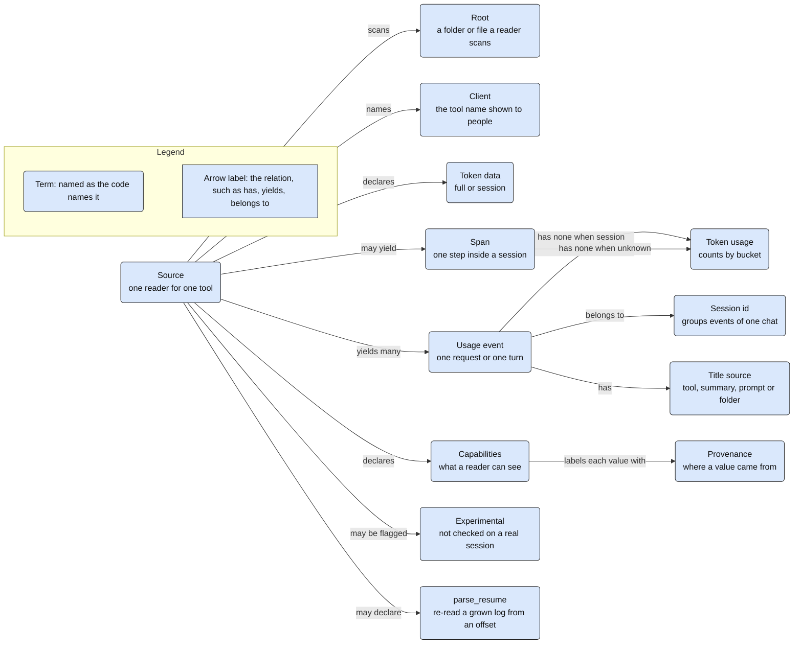

# Reader glossary map

This map shows the words used for readers and how they relate to each other. It helps a new person and a business reader mean the same thing when they say source, root, event or span. Each term is named exactly as the code names it.

## What the diagram shows

- A Source is the record that describes one reader. It names the files it scans through its default roots and a files function. `src/ai_usage_cost/sources/base.py:18` `src/ai_usage_cost/sources/base.py:22`
- A Source names its clients, which are the tool names shown to people. `src/ai_usage_cost/sources/base.py:21`
- A Source declares token data, which is full or session. `src/ai_usage_cost/sources/base.py:14`
- A Source yields many usage events and may also yield spans. `src/ai_usage_cost/sources/base.py:24` `src/ai_usage_cost/sources/base.py:27`
- A Source declares capabilities, and each capability is labelled with a provenance. `src/ai_usage_cost/sources/base.py:28` `src/ai_usage_cost/trace.py:105`
- A Source may be flagged experimental when its parser was built from the tool's source and synthetic fixtures. `src/ai_usage_cost/sources/base.py:29` `src/ai_usage_cost/sources/base.py:31`
- A Source may declare parse_resume, which reads a grown log again from a byte offset. `src/ai_usage_cost/sources/base.py:40`
- A usage event has token usage only when the reader can see tokens, belongs to a session id and carries a title source. `src/ai_usage_cost/models.py:57` `src/ai_usage_cost/models.py:55` `src/ai_usage_cost/models.py:65`
- A span has token usage only when the log reports it. `src/ai_usage_cost/trace.py:76`

## Capability and related functionality

- The map supports the shared language of the readers package. The glossary entries for reader, root, token data and experimental reader are listed in [[Ai usage cost sources Ontology]]. [[Ai usage cost sources Overview]] explains the readers in prose, and [[Ai usage cost sources Workflows]] walks through a scan. The sibling views are [[Readers concepts]], [[Reader types]], [[Reader data lineage]], [[Reader module imports]], [[Reader glossary map]], [[Readers component view]] and [[Readers data flow]].
- Terms for the cost side of the product, such as priced and unpriced, belong to the pricing chunk, not to this map.

## The diagram

%% generated:diagram-src-terms start (do not edit; run brain docs generate) %%

%% generated:diagram-src-terms end %%

> [!example]- Code references
> | Code | What it shows |
> |---|---|
> | `src/ai_usage_cost/sources/base.py:18` | Source, root, client, token data, capabilities, experimental and resume |
> | `src/ai_usage_cost/models.py:49` | Usage event, session id and title source |
> | `src/ai_usage_cost/trace.py:55` | Span |
> | `src/ai_usage_cost/models.py:9` | Provenance values |
