# Reader module imports

This diagram shows which reader modules depend on which, so a change can be made in the right place. Almost everything depends on one shared helper module, and a few readers are thin wrappers over a family builder. There are no circular imports, which keeps each reader easy to test on its own.

## What the diagram shows

- The shared module imports the usage event model and the trace types, and nothing else from the application. `src/ai_usage_cost/sources/base.py:11` `src/ai_usage_cost/sources/base.py:12`
- The package module imports the shared module for the Source type, and finds the reader modules at run time by name instead of importing them. `src/ai_usage_cost/sources/__init__.py:6` `src/ai_usage_cost/sources/__init__.py:16`
- Log file readers import the shared helpers, the models and the trace types. Claude Code is an example. `src/ai_usage_cost/sources/claude_code.py:8` `src/ai_usage_cost/sources/claude_code.py:9` `src/ai_usage_cost/sources/claude_code.py:10`
- Database readers import the same three modules. Cursor is an example. `src/ai_usage_cost/sources/cursor.py:10` `src/ai_usage_cost/sources/cursor.py:11` `src/ai_usage_cost/sources/cursor.py:12`
- The Cline module is the builder of its family, and Roo Code and Kilo Code legacy import its Spec, its builder, its root finder and a private table of cache rules. `src/ai_usage_cost/sources/cline.py:66` `src/ai_usage_cost/sources/roo_code.py:12` `src/ai_usage_cost/sources/kilo_legacy.py:12`
- The OpenCode module is the builder of the second family, and Kilo Code imports its builder. `src/ai_usage_cost/sources/opencode.py:32` `src/ai_usage_cost/sources/kilo_code.py:9`
- The models and trace modules that the shared module imports do not import the readers back, so the graph has no cycle. `src/ai_usage_cost/trace.py:10` `src/ai_usage_cost/sources/base.py:12`

## Capability and related functionality

- The diagram realises the extension point capability: a new reader is one module that imports the shared helpers, the models and the trace types. [[Ai usage cost sources Overview]] explains the readers in prose, and [[Ai usage cost sources Workflows]] walks through a scan. The sibling views are [[Readers concepts]], [[Reader types]], [[Reader data lineage]], [[Reader module imports]], [[Reader glossary map]], [[Readers component view]] and [[Readers data flow]].
- The module map generated for the whole package is in [[Ai usage cost sources Diagrams]]. One smell is recorded in the specification: Roo Code and Kilo Code legacy import a name that starts with an underscore from the Cline module.

## The diagram

%% generated:diagram-src-imports start (do not edit; run brain docs generate) %%

```mermaid
flowchart TD
    subgraph outside["Outside the chunk"]
        models["models.py<br/>UsageEvent, TokenUsage"]:::external
        trace["trace.py<br/>Span, Capabilities"]:::external
    end
    subgraph shared["Registry and shared helpers"]
        reg["sources/__init__.py<br/>registry, client_labels"]:::module
        base["base.py<br/>Source, read helpers"]:::module
    end
    subgraph families["Readers built by a shared make_source"]
        cline["cline.py<br/>Spec, make_source"]:::module
        roo["roo_code.py"]:::module
        kilol["kilo_legacy.py"]:::module
        opencode["opencode.py<br/>make_source"]:::module
        kilo["kilo_code.py"]:::module
    end
    subgraph direct["Readers that build Source directly"]
        logs["Log file readers<br/>claude_code, codex, copilot_cli, gemini_cli, grok_build,<br/>jan, muse_code, openai_compat, qwen_code, antigravity"]:::module
        dbs["Database readers<br/>copilot_chat, cursor, dyad, ollama_app, windsurf"]:::module
    end
    base --> models
    base --> trace
    reg --> base
    reg -.->|imports each module by name| logs
    reg -.->|imports each module by name| dbs
    reg -.->|imports each module by name| cline
    reg -.->|imports each module by name| opencode
    logs --> base
    dbs --> base
    cline --> base
    opencode --> base
    roo --> cline
    kilol --> cline
    kilo --> opencode
    logs --> models
    dbs --> models
    logs --> trace
    dbs --> trace
    cline --> models
    cline --> trace
    opencode --> models
    opencode --> trace
    subgraph Legend
        direction LR
        zlegend_a["Module or package in this chunk"]:::module
        zlegend_b["Module outside this chunk"]:::external
        zlegend_c["Layer: a group of modules"]:::module
        zlegend_d["Solid arrow: A imports B"]:::module
        zlegend_e["Dashed arrow: imported by name at run time"]:::module
        zlegend_f["Red arrow would mark a cycle, none found"]:::cycle
        zlegend_a ~~~ zlegend_b ~~~ zlegend_c ~~~ zlegend_d ~~~ zlegend_e ~~~ zlegend_f
    end
    classDef module fill:#dae8fc,stroke:#222222,color:#111111
    classDef external fill:#eeeeee,stroke:#222222,stroke-dasharray:5 3,color:#111111
    classDef cycle fill:#f8cecc,stroke:#b85450,color:#111111
```

%% generated:diagram-src-imports end %%

> [!example]- Code references
> | Code | What it shows |
> |---|---|
> | `src/ai_usage_cost/sources/base.py:11` | Shared module imports |
> | `src/ai_usage_cost/sources/__init__.py:6` | Package module import |
> | `src/ai_usage_cost/sources/roo_code.py:12` | Family import by a thin reader |
> | `src/ai_usage_cost/sources/kilo_code.py:9` | Second family import |
