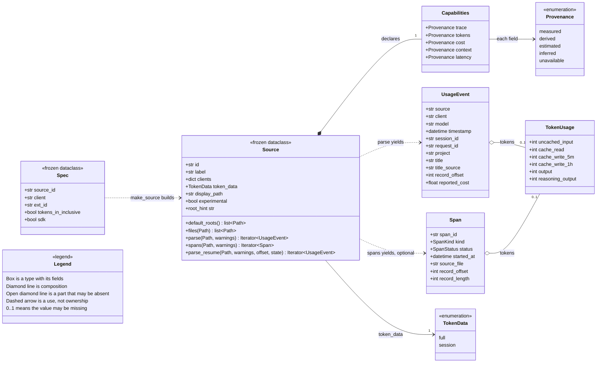

# Reader types

This diagram shows the few data types that every reader is built from and what each one holds. A reader describes itself with one record, produces usage records, and may add step by step spans. Knowing these shapes is enough to read any reader module or to write a new one.

## What the diagram shows

- Source is a frozen dataclass with an id, a label, a client map, a default roots function, a files function, a parse function, a token data flag and a display path. `src/ai_usage_cost/sources/base.py:18` `src/ai_usage_cost/sources/base.py:24` `src/ai_usage_cost/sources/base.py:26`
- Its optional parts are a spans function, a capabilities value, an experimental flag and a resume function. `src/ai_usage_cost/sources/base.py:27` `src/ai_usage_cost/sources/base.py:28` `src/ai_usage_cost/sources/base.py:40`
- Token data is a two value type, full or session. `src/ai_usage_cost/sources/base.py:14`
- Capabilities holds five labels, one each for trace, tokens, cost, context and latency, and every label defaults to unavailable. `src/ai_usage_cost/trace.py:104` `src/ai_usage_cost/trace.py:109`
- Provenance has five values: measured, derived, estimated, inferred and unavailable. `src/ai_usage_cost/models.py:9`
- A usage event names its source, client, model, timestamp, session and request, and may carry token usage, a title with its source and the cost the tool logged itself. `src/ai_usage_cost/models.py:49` `src/ai_usage_cost/models.py:57` `src/ai_usage_cost/models.py:72`
- Token usage splits counts into uncached input, cache read, two cache write buckets, output and reasoning output. `src/ai_usage_cost/models.py:12` `src/ai_usage_cost/models.py:16`
- A span has an id, a kind, a status, a start time and the file, offset and length of the record it came from. `src/ai_usage_cost/trace.py:55` `src/ai_usage_cost/trace.py:84`
- Spec is a frozen dataclass with a source id, a client name, an extension id, a flag for whether input tokens include cache, and an sdk flag. The Cline builder turns a Spec into a Source. `src/ai_usage_cost/sources/cline.py:82` `src/ai_usage_cost/sources/cline.py:86` `src/ai_usage_cost/sources/cline.py:410`

## Capability and related functionality

- The diagram realises the reader contract capability: the typed boundary between a tool's files and the rest of the application. [[Ai usage cost sources Overview]] explains the readers in prose, and [[Ai usage cost sources Workflows]] walks through a scan. The sibling views are [[Readers concepts]], [[Reader types]], [[Reader data lineage]], [[Reader module imports]], [[Reader glossary map]], [[Readers component view]] and [[Readers data flow]].
- The models behind the diagram live outside this chunk. The usage event and token usage are described with the other chunks of the package, and the contract itself is in [[Ai usage cost sources Data Model]].

## The diagram

%% generated:diagram-src-types start (do not edit; run brain docs generate) %%

%% generated:diagram-src-types end %%

> [!example]- Code references
> | Code | What it shows |
> |---|---|
> | `src/ai_usage_cost/sources/base.py:18` | Reader record |
> | `src/ai_usage_cost/sources/cline.py:82` | Specification used by the Cline family builder |
> | `src/ai_usage_cost/trace.py:104` | Per reader capability labels |
> | `src/ai_usage_cost/models.py:49` | Usage record produced by parse |
> | `src/ai_usage_cost/models.py:12` | Token buckets |
> | `src/ai_usage_cost/trace.py:55` | Step record produced by spans |
