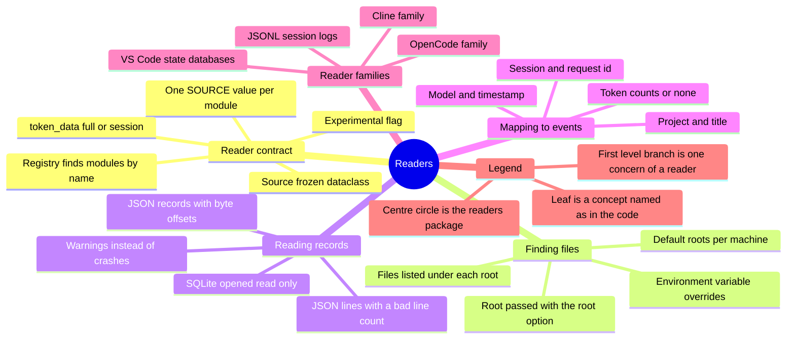

# Readers concepts

This picture gives a newcomer the main ideas of the readers package on one page. A reader is a small module that turns one tool's local files into usage records without changing anything. Seeing the five concerns together makes it easier to add a reader or to judge what a number can be trusted for.

## What the diagram shows

- The reader contract branch: each reader module holds one value named SOURCE, an instance of the frozen dataclass Source. `src/ai_usage_cost/sources/base.py:18` `src/ai_usage_cost/sources/claude_code.py:672`
- The registry imports every module of the package except the base module and keeps the ones that hold a SOURCE value of type Source. `src/ai_usage_cost/sources/__init__.py:14` `src/ai_usage_cost/sources/__init__.py:17` `src/ai_usage_cost/sources/__init__.py:18`
- Token data is either full or session, and a reader can be flagged experimental. `src/ai_usage_cost/sources/base.py:14` `src/ai_usage_cost/sources/base.py:31`
- The finding files branch: a reader computes its default roots per machine, some of them moved by an environment variable, and a root can also be passed with the root option. `src/ai_usage_cost/sources/base.py:22` `src/ai_usage_cost/sources/gemini_cli.py:32` `src/ai_usage_cost/sources/base.py:44`
- Each reader lists the files under a root with its own files function. `src/ai_usage_cost/sources/base.py:23`
- The reading records branch: JSON lines are read with a count of lines that fail to parse, and the count becomes one warning per file. `src/ai_usage_cost/sources/base.py:69` `src/ai_usage_cost/sources/base.py:84`
- JSON records can also be read with the byte offset and length of each record, starting from a given offset. `src/ai_usage_cost/sources/base.py:87` `src/ai_usage_cost/sources/base.py:99`
- SQLite files are opened through a read only URI, and a database error becomes a warning instead of a crash. `src/ai_usage_cost/sources/base.py:123` `src/ai_usage_cost/sources/base.py:128`
- The mapping to events branch: an event carries a model, a timestamp, a session id, a request id, a project, a title and optional token counts. `src/ai_usage_cost/models.py:55` `src/ai_usage_cost/models.py:56` `src/ai_usage_cost/models.py:57`
- The project is the last segment of the working directory, and the fallback title joins the project and the session id. `src/ai_usage_cost/sources/base.py:159` `src/ai_usage_cost/sources/base.py:176`
- The reader families branch: Roo Code and Kilo Code legacy are thin modules over the Cline family builder, and Kilo Code reuses the OpenCode builder. `src/ai_usage_cost/sources/roo_code.py:12` `src/ai_usage_cost/sources/kilo_code.py:9`
- Cursor and Windsurf read keys out of the VS Code state database, and the JSONL readers such as Claude Code list every JSONL file under a root. `src/ai_usage_cost/sources/cursor.py:59` `src/ai_usage_cost/sources/windsurf.py:47` `src/ai_usage_cost/sources/claude_code.py:677`

## Capability and related functionality

- The map supports onboarding to the readers package: it names the concerns before a reader opens any file. [[Ai usage cost sources Overview]] explains the readers in prose, and [[Ai usage cost sources Workflows]] walks through a scan. The sibling views are [[Readers concepts]], [[Reader types]], [[Reader data lineage]], [[Reader module imports]], [[Reader glossary map]], [[Readers component view]] and [[Readers data flow]].
- The concepts match the notes of the chunk: the contract in the overview, the reading rules in [[Ai usage cost sources Security]], and the families in [[Ai usage cost sources API]].

## The diagram

%% generated:diagram-src-concepts start (do not edit; run brain docs generate) %%

%% generated:diagram-src-concepts end %%

> [!example]- Code references
> | Code | What it shows |
> |---|---|
> | `src/ai_usage_cost/sources/base.py:18` | The reader contract |
> | `src/ai_usage_cost/sources/__init__.py:11` | Registry that finds readers by name |
> | `src/ai_usage_cost/sources/base.py:117` | Read only SQLite access |
> | `src/ai_usage_cost/sources/base.py:140` | Timestamp mapping |
> | `src/ai_usage_cost/sources/roo_code.py:21` | A family member built by a shared builder |
