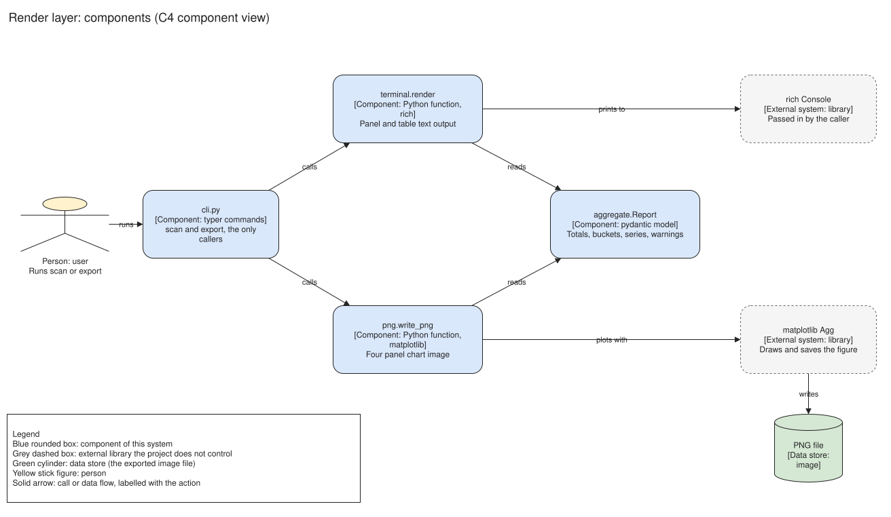

# Render layer components

This view shows how a finished usage and cost report becomes something a person can read. One path prints a summary in the terminal. The other saves a picture that can be shared or filed. Seeing both side by side makes clear that neither one computes any cost itself.

## What the diagram shows

A person runs the scan command or the export command of the command line tool. `src/ai_usage_cost/cli.py:71-72` `src/ai_usage_cost/cli.py:175-176`

The scan command builds a report and, unless JSON was asked for, hands it to the terminal renderer together with a console. `src/ai_usage_cost/cli.py:87-105`

The export command calls the picture writer only when the output file name ends in .png. `src/ai_usage_cost/cli.py:186-192`

The terminal renderer reads the report totals and one chosen group of buckets, and prints them through the rich console it was given. `src/ai_usage_cost/render/terminal.py:17-31`

The picture writer reads the same report and draws four charts with matplotlib on the Agg backend, which needs no screen. `src/ai_usage_cost/render/png.py:7-11` `src/ai_usage_cost/render/png.py:18-29`

The picture writer creates the parent folder of the output path and saves the figure there. `src/ai_usage_cost/render/png.py:31-33`

## Capability and related functionality

The capability is the presentation of a priced usage report in two forms. It sits behind the commands described in [[Ai usage cost render Overview]]. The report itself is built outside this layer, in the aggregation code of the main package.

The dashboard does not use this layer. The report it reads comes from the HTTP route in `src/ai_usage_cost/api.py`, not from these two files.

## Render layer components

> [!example]- Code references
> | Code | What it shows |
> |---|---|
> | `src/ai_usage_cost/cli.py:71-105` | scan command calling the terminal renderer |
> | `src/ai_usage_cost/cli.py:175-196` | export command calling the picture writer |
> | `src/ai_usage_cost/render/terminal.py:17-46` | terminal renderer |
> | `src/ai_usage_cost/render/png.py:18-33` | picture writer |
> | `src/ai_usage_cost/aggregate.py:462-482` | report model both renderers read |
