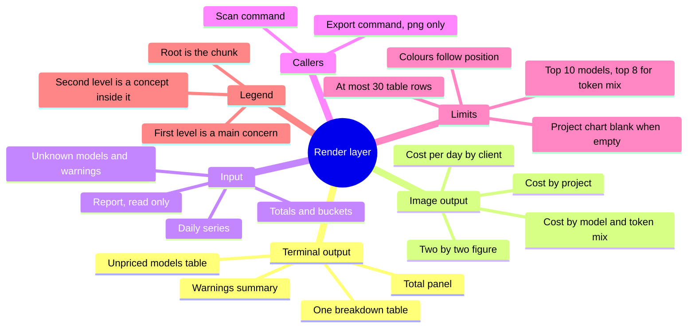

# Render layer mind map

This picture gives a newcomer the render layer on one page. It shows that the layer only presents a finished report, either as a summary in the terminal or as an image, and that it computes no cost. It helps a reader decide whether a change belongs here or in the report code.

## What the diagram shows

The terminal output prints a Total panel, one breakdown table chosen by the caller, a table of unpriced models and a warnings summary `src/ai_usage_cost/render/terminal.py:17-46`. The Total panel holds the cost, the token and request counts, the date span and the caching saving `src/ai_usage_cost/render/terminal.py:49-67`.

The image output draws a two by two figure, titled with the totals, and saves it `src/ai_usage_cost/render/png.py:18-33`. It selects the Agg backend before it loads the plotting library, so no screen is needed `src/ai_usage_cost/render/png.py:7-11`. Colours come from a seven colour list `src/ai_usage_cost/render/png.py:15-15`.

Both outputs read a report and nothing else: the terminal renderer picks its table from the report buckets `src/ai_usage_cost/render/terminal.py:22-28`, and the picture writer reads the daily series `src/ai_usage_cost/render/png.py:36-40`.

Two commands call the layer. The scan command renders to the terminal after it has built the report `src/ai_usage_cost/cli.py:105-105`. The export command calls the picture writer only for an output name ending in png `src/ai_usage_cost/cli.py:186-192`.

Limits: a terminal table prints at most 30 rows `src/ai_usage_cost/render/terminal.py:79-79`. The model chart keeps the top 10, the token mix chart the top 8 and the project chart the top 10 `src/ai_usage_cost/render/png.py:59-59` `src/ai_usage_cost/render/png.py:71-71` `src/ai_usage_cost/render/png.py:90-90`. The project chart is left blank when the report has no project buckets `src/ai_usage_cost/render/png.py:91-93`. Colours follow the position in each chart, so one colour means a different thing in each panel `src/ai_usage_cost/render/png.py:49-49` `src/ai_usage_cost/render/png.py:63-63` `src/ai_usage_cost/render/png.py:81-81`.

## Capability and related functionality

The capability is orientation for the presentation of a priced usage report. The detailed view is [[Render layer components]], the file by file text is [[Ai usage cost render Overview]], and the imports are drawn in [[Render layer module dependencies]].

## Render layer mind map

%% generated:diagram-render-concepts start (do not edit; run brain docs generate) %%

%% generated:diagram-render-concepts end %%

> [!example]- Code references
> | Code | What it shows |
> |---|---|
> | `src/ai_usage_cost/render/terminal.py:17-46` | The terminal renderer |
> | `src/ai_usage_cost/render/terminal.py:49-67` | The Total panel |
> | `src/ai_usage_cost/render/png.py:18-33` | The picture writer |
> | `src/ai_usage_cost/cli.py:105-105` | Scan command calls the renderer |
> | `src/ai_usage_cost/cli.py:186-192` | Export command calls the picture writer |
