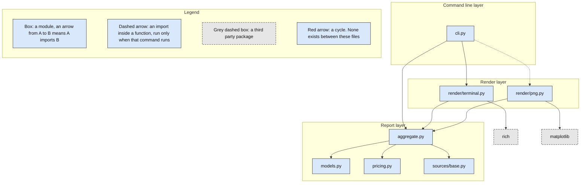

# Render layer module dependencies

This view shows what the render files import. They depend on the report code and on two third party libraries, and no file outside the layer imports them except the command line. A maintainer can change how output looks without touching how cost is computed.

## What the diagram shows

The command line module imports the terminal renderer at the top of the file `src/ai_usage_cost/cli.py:22-22`, and imports the picture writer inside the export command, so only that command loads it `src/ai_usage_cost/cli.py:190-190`. It also imports the report type `src/ai_usage_cost/cli.py:17-17`.

The terminal renderer imports the report and bucket types from the report module and three parts of the rich library `src/ai_usage_cost/render/terminal.py:3-7`.

The picture writer imports the report type and the matplotlib library `src/ai_usage_cost/render/png.py:7-13`.

The report module imports the shared models, the pricing matcher and a helper from the sources base `src/ai_usage_cost/aggregate.py:11-13`. It does not import the render layer.

No cycle exists between these files. The generated folder view in [[Ai usage cost render Diagrams]] shows a loop only because the command line module and the report module sit in the parent folder of the render folder.

## Capability and related functionality

The capability is a clear boundary: the layer sits between the command line and the report code. The component view is [[Render layer components]] and the one page summary is [[Render layer mind map]].

## Render layer module dependencies

%% generated:diagram-render-imports start (do not edit; run brain docs generate) %%

%% generated:diagram-render-imports end %%

%% generated:node-citations-render-imports start (do not edit; run brain docs generate) %%
### Node citations

- cli: `src/ai_usage_cost/cli.py:17-22`
- terminal: `src/ai_usage_cost/render/terminal.py:3-7`
- png: `src/ai_usage_cost/render/png.py:7-13`
- aggregate: `src/ai_usage_cost/aggregate.py:11-13`
- models: `src/ai_usage_cost/aggregate.py:11-11`
- pricing: `src/ai_usage_cost/aggregate.py:12-12`
- sourcesbase: `src/ai_usage_cost/aggregate.py:13-13`
- rich: `src/ai_usage_cost/render/terminal.py:3-5`
- mpl: `src/ai_usage_cost/render/png.py:7-11`
%% generated:node-citations-render-imports end %%

> [!example]- Code references
> | Code | What it shows |
> |---|---|
> | `src/ai_usage_cost/cli.py:17-22` | Command line imports |
> | `src/ai_usage_cost/cli.py:190-190` | Import inside the export command |
> | `src/ai_usage_cost/render/terminal.py:3-7` | Terminal renderer imports |
> | `src/ai_usage_cost/render/png.py:7-13` | Picture writer imports |
> | `src/ai_usage_cost/aggregate.py:11-13` | Report module imports |
