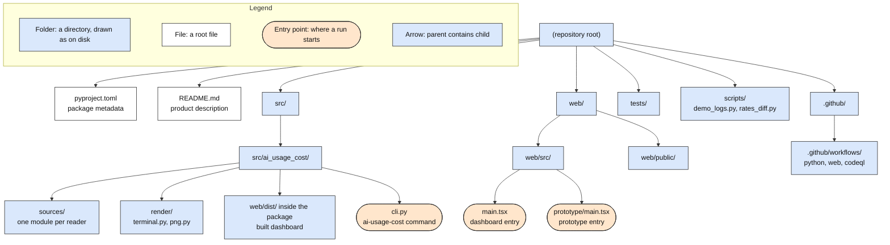

# Repository folder layout

This tree shows how the repository is laid out on disk and where each run starts. A newcomer can find the Python package, the dashboard source, the tests and the automatic checks in one look. It saves the time otherwise spent opening folders to learn what lives where.

## What the diagram shows

- The README layout lists the package folder with its sources and render folders, the scripts folder and the web folder. `README.md:621` `README.md:625` `README.md:635`
- The scripts folder holds two maintainer tools, and the web folder holds the dashboard source. `README.md:636` `README.md:637`
- The tests folder is the test path of pytest. `pyproject.toml:52`
- The package metadata file declares the package and installs the console command, whose entry point is the app object in the command line module. `pyproject.toml:30` `src/ai_usage_cost/cli.py:24`
- The dashboard page loads its entry file from the source folder, and the prototype page loads a second entry file from the prototype folder. `web/index.html:26` `web/prototype.html:25`
- The public folder of the web project holds the logo used by the README. `README.md:2`
- The build writes the dashboard into a folder named web/dist inside the package folder. `web/vite.config.ts:15`
- The workflows folder holds the Python, Web and CodeQL workflows. `.github/workflows/python.yml:1` `.github/workflows/web.yml:1` `.github/workflows/codeql.yml:1`

## Capability and related functionality

- The tree realises the orientation capability of the repository root: it answers where code lives before a reader opens a folder. Details of the root files are in [[localtokenomics root Overview]].
- The folders under the package have their own chunks, for example [[Ai usage cost sources Overview]] and [[Ai usage cost render Overview]].
- Related maps of the root are [[Repository root concepts]], [[Repository root capabilities]] and [[Repository root configuration]]; the build flow is in [[LocalTokenomics root wiring]].

## The diagram

%% generated:diagram-root-folders start (do not edit; run brain docs generate) %%

%% generated:diagram-root-folders end %%

> [!example]- Code references
> | Code | What it shows |
> |---|---|
> | `README.md:621` | Package layout in the README |
> | `pyproject.toml:51` | Tests folder |
> | `pyproject.toml:29` | Console command entry |
> | `web/index.html:26` | Dashboard entry file |
> | `web/prototype.html:25` | Prototype entry file |
> | `web/vite.config.ts:15` | Built dashboard folder |
