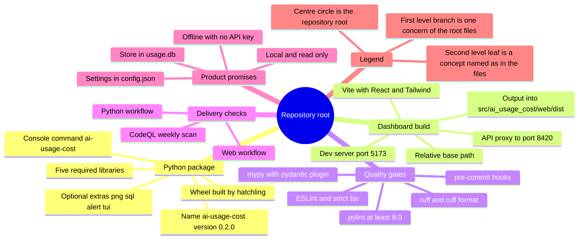

# Repository root concepts

This picture gives a newcomer the main ideas of the repository root on one page. The root ties a Python tool and a web dashboard into one package and keeps both honest with automatic checks. Reading it first makes the longer notes easier to follow.

## What the diagram shows

- The Python package branch holds the project name and the one console command it installs. `pyproject.toml:2` `pyproject.toml:30`
- Five libraries are required and everything else is an optional extra, so a plain install stays small. `pyproject.toml:7` `pyproject.toml:15`
- The wheel is built by hatchling. `pyproject.toml:34`
- The dashboard branch names the Vite plugins, the relative base path and the output folder inside the Python package. `web/vite.config.ts:8` `web/vite.config.ts:7` `web/vite.config.ts:15`
- The development server listens on port 5173 and forwards API calls to the Python server on port 8420. `web/vite.config.ts:19` `web/vite.config.ts:22`
- The quality branch lists the Python lint rule families, the mypy plugin and the pylint threshold. `pyproject.toml:44` `pyproject.toml:48` `pyproject.toml:113`
- On the dashboard side the type checker runs in strict mode and ESLint warns about files that export more than components. `web/tsconfig.json:19` `web/eslint.config.js:22`
- The delivery branch lists the three workflows: Python, Web and a CodeQL scan that also runs weekly. `.github/workflows/python.yml:1` `.github/workflows/web.yml:1` `.github/workflows/codeql.yml:8`
- The product promises branch repeats what the README tells a reader: local, read only, offline, with optional settings and a local store. `README.md:26` `README.md:433` `README.md:475`

## Capability and related functionality

- The map supports onboarding to the repository root. Its detail is in [[localtokenomics root Overview]] and [[localtokenomics root Operations]].
- The folders behind these concepts are drawn in [[Repository folder layout]]; the files that configure them are listed in [[Repository root configuration]].
- The jobs the root files perform are grouped in [[Repository root capabilities]]; the build and check flow is in [[LocalTokenomics root wiring]].

## The diagram

%% generated:diagram-root-concepts start (do not edit; run brain docs generate) %%

%% generated:diagram-root-concepts end %%

> [!example]- Code references
> | Code | What it shows |
> |---|---|
> | `pyproject.toml:29` | Console command table |
> | `web/vite.config.ts:14` | Build output folder and folder clearing |
> | `web/vite.config.ts:18` | Development server port and API proxy |
> | `pyproject.toml:112` | Pylint score threshold |
> | `.github/workflows/codeql.yml:7` | Weekly CodeQL trigger |
> | `README.md:433` | Optional settings file the README documents |
