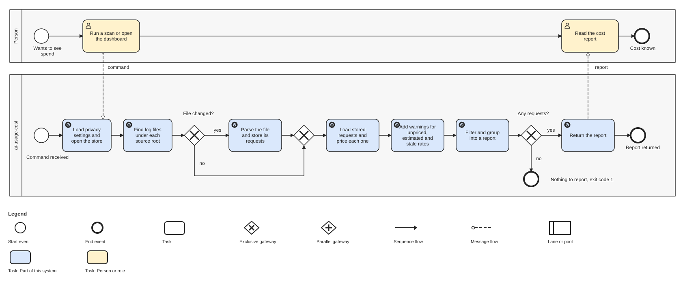

# Scan and report process

This view shows the scan as a business process between a person and the tool. The person asks to see their spend, and the tool does the reading, pricing and adding up. It also shows the one case where nothing is produced, which helps when explaining an empty result.

## What the diagram shows

- The person starts the process by running the scan command or opening the dashboard. `src/ai_usage_cost/cli.py:72`
- The tool loads the privacy settings and opens the store. `src/ai_usage_cost/pipeline.py:175` `src/ai_usage_cost/pipeline.py:176`
- It finds the log files under each source root. `src/ai_usage_cost/store.py:220`
- A file that has not changed is skipped. `src/ai_usage_cost/store.py:230`
- A changed file is parsed and its requests are stored. `src/ai_usage_cost/store.py:255` `src/ai_usage_cost/store.py:271`
- The stored requests are loaded and each one is priced. `src/ai_usage_cost/pipeline.py:186` `src/ai_usage_cost/pipeline.py:198`
- Warnings are added for unpriced and estimated models and for old rates. `src/ai_usage_cost/pipeline.py:212` `src/ai_usage_cost/pipeline.py:235`
- The requests are filtered and grouped into a report. `src/ai_usage_cost/pipeline.py:335`
- With no requests the command ends with exit code 1. `src/ai_usage_cost/cli.py:98` `src/ai_usage_cost/cli.py:104`
- With requests the report is returned and the person reads it. `src/ai_usage_cost/cli.py:105`

## Capability and related functionality

- Realises the scan capability described in [[Ai usage cost Workflows]].
- The technical order of the same process is [[Scan pipeline from logs to report]], and the data it moves is [[Usage data flow]].
- The pricing step inside the process is opened up in [[How one request is priced]].

## The diagram

> [!example]- Code references
> | Code | What it shows |
> |---|---|
> | `src/ai_usage_cost/cli.py:72` | The command that starts the process |
> | `src/ai_usage_cost/pipeline.py:166` | Settings, store, ingest, pricing and warnings |
> | `src/ai_usage_cost/store.py:190` | The file loop with its skip decision |
> | `src/ai_usage_cost/pipeline.py:305` | Filtering and grouping |
