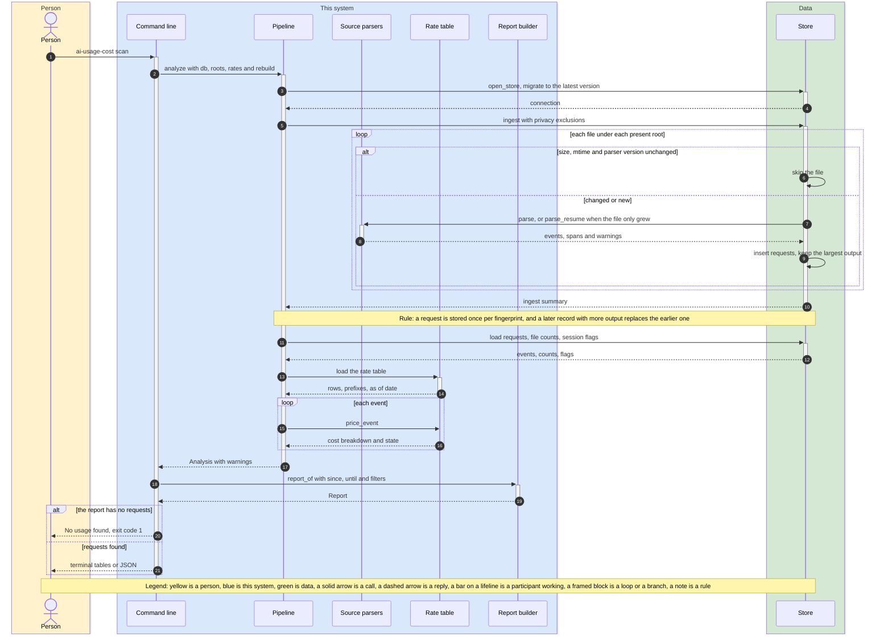

# Scan pipeline from logs to report

This view follows one scan from the command a person types to the report that appears on screen. It shows which parts of the tool do the work and in what order. A reader can see why a repeated scan is fast and where a warning about rates comes from.

## What the diagram shows

- The person starts a scan from the command line, which asks the pipeline for an analysis. `src/ai_usage_cost/cli.py:87`
- The pipeline loads the privacy settings and opens the store. `src/ai_usage_cost/pipeline.py:175` `src/ai_usage_cost/pipeline.py:176`
- Opening the store applies every migration the store has not seen yet. `src/ai_usage_cost/store.py:147`
- Ingest visits the files under each source root that exists. `src/ai_usage_cost/store.py:219`
- A file whose modification time, size and parser version are unchanged is skipped. `src/ai_usage_cost/store.py:230`
- A file that only grew is read from where the last scan stopped when its source allows it. `src/ai_usage_cost/store.py:252`
- Any other changed or new file is parsed again in full. `src/ai_usage_cost/store.py:255`
- A request is stored once per fingerprint, and a later record with more output replaces the earlier one. `src/ai_usage_cost/store.py:356`
- The pipeline then loads the stored requests, the file counts and the session flags. `src/ai_usage_cost/pipeline.py:186`
- It loads the rate table and prices each request. `src/ai_usage_cost/pipeline.py:192` `src/ai_usage_cost/pipeline.py:198`
- Warnings are added for models without a rate. `src/ai_usage_cost/pipeline.py:212`
- The command line turns the analysis into a report limited by date and client. `src/ai_usage_cost/cli.py:88` `src/ai_usage_cost/pipeline.py:305`
- When the report holds no requests the command prints a notice and exits with code 1. `src/ai_usage_cost/cli.py:104`
- Otherwise the command prints the tables. `src/ai_usage_cost/cli.py:105`

## Capability and related functionality

- Realises the scan capability described in [[Ai usage cost Workflows]], the command that most people run first.
- The same run seen as data movement is [[Usage data flow]], and as a business process it is [[Scan and report process]].
- The pricing step is opened up in [[How one request is priced]], and the states a priced request can end in are in [[Cost state of a request]].
- The HTTP routes that reuse this pipeline are listed in [[Ai usage cost API]].

## The diagram

%% generated:diagram-seq-scan-pipeline start (do not edit; run brain docs generate) %%

%% generated:diagram-seq-scan-pipeline end %%

> [!example]- Code references
> | Code | What it shows |
> |---|---|
> | `src/ai_usage_cost/cli.py:72` | The scan command |
> | `src/ai_usage_cost/pipeline.py:166` | Analysis: ingest, load, price, warn |
> | `src/ai_usage_cost/store.py:190` | Incremental ingest with skip and resume |
> | `src/ai_usage_cost/pricing.py:429` | Pricing of one request |
> | `src/ai_usage_cost/pipeline.py:305` | Filtering and report building |
