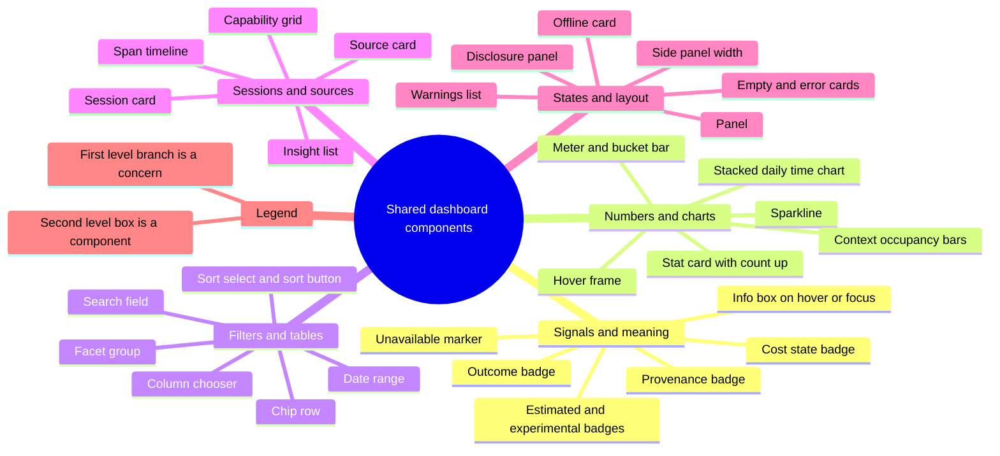

# Shared components concepts

This map gives a newcomer the whole vocabulary of the shared dashboard parts on one page. It shows which names exist for signals, numbers, filters, sessions and page states. A developer can find the right part before searching the code.

## What the diagram shows

Signals and meaning is the first branch: badges for cost state, provenance, outcome, estimated and experimental, plus the word unavailable and the info box that explains a badge. `web/src/components/status.tsx:149-165` `web/src/components/status.tsx:197-218` `web/src/components/status.tsx:220-236` `web/src/components/status.tsx:175-177` `web/src/components/status.tsx:77-94` `web/src/components/metric-info.tsx:46-191`

Numbers and charts is the second branch: the stat card, the sparkline, the stacked daily chart, the hover frame, the bucket bar and the context occupancy bars. `web/src/components/stat.tsx:61-155` `web/src/components/sparkline.tsx:89-145` `web/src/components/chart-time.tsx:23-184` `web/src/components/chart-hover.tsx:18-121` `web/src/components/status.tsx:286-322` `web/src/components/trace.tsx:45-212`

Filters and tables is the third branch: search, facet checkboxes, date range, chips, the two sort controls and the column chooser. `web/src/components/filters.tsx:18-54` `web/src/components/filters.tsx:63-118` `web/src/components/filters.tsx:156-193` `web/src/components/filters.tsx:120-154` `web/src/components/filters.tsx:195-222` `web/src/components/states.tsx:29-66` `web/src/components/columns.tsx:62-95`

Sessions and sources is the fourth branch: the session and source cards, the span timeline, the insight list and the capability grid. `web/src/components/session.tsx:117-205` `web/src/components/source-card.tsx:33-64` `web/src/components/trace.tsx:227-315` `web/src/components/trace.tsx:332-406` `web/src/components/trace.tsx:416-435`

States and layout is the fifth branch: the panel, the empty, error and offline cards, the warnings list, the disclosure panel and the remembered side panel width. `web/src/components/panel.tsx:5-13` `web/src/components/states.tsx:68-96` `web/src/components/states.tsx:98-121` `web/src/components/states.tsx:280-328` `web/src/components/states.tsx:247-278` `web/src/components/states.tsx:136-172` `web/src/components/workspace-panel.ts:49-73`

The Legend branch says that a first level branch is a concern and a second level box is one component. The names are the exported names in the code.

## Capability and related functionality

The map realises the shared display layer of the dashboard in concepts rather than imports. The detailed structure is in [[Shared components C4]] and [[Dashboard component composition]]. The explanation of each part is in [[Web UI components Overview]], and the tests are in [[Web UI components Tests]].

## Shared components concepts

%% generated:diagram-shared-components-concepts start (do not edit; run brain docs generate) %%

%% generated:diagram-shared-components-concepts end %%

> [!example]- Code references
> | Code | What it shows |
> |---|---|
> | `web/src/components/status.tsx:149-165` | Cost state badge |
> | `web/src/components/chart-time.tsx:23-184` | Stacked daily chart |
> | `web/src/components/columns.tsx:62-95` | Column chooser |
> | `web/src/components/trace.tsx:227-315` | Span timeline |
> | `web/src/components/states.tsx:280-328` | Offline card |
> | `web/src/components/states.tsx:247-278` | Warnings list |
