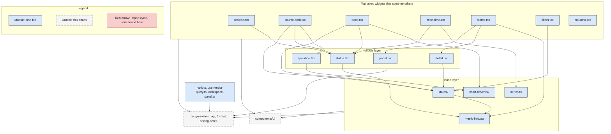

# Shared components imports

This graph shows which shared component files import which. It lets a developer see how far a change to a base file reaches before editing it. The graph also confirms that dependencies run one way, from big widgets down to small parts.

## What the diagram shows

The base layer holds the metric info box, the stat card, the hover frame and the series colours, and the stat card imports the info box. `web/src/components/stat.tsx:4-4` `web/src/components/sparkline.tsx:1-1`

The status badges and the page states also import the info box. `web/src/components/status.tsx:4-4` `web/src/components/states.tsx:15-15`

The detail helpers import the stat label, and so do the filters. `web/src/components/detail.tsx:4-4` `web/src/components/filters.tsx:15-15`

The page states import the code block, the panel parts and the info box. `web/src/components/states.tsx:13-14`

The source card imports the sparkline, the badges and the stat label, and the sparkline imports the hover frame. `web/src/components/source-card.tsx:4-6` `web/src/components/sparkline.tsx:1-1`

The session card imports the badge metadata, and the trace widgets import the hover frame, the badges and the stat label. `web/src/components/session.tsx:5-5` `web/src/components/trace.tsx:5-9`

The time chart imports the series colours and the key list from the badges. `web/src/components/chart-time.tsx:10-11`

The column chooser, the info box and the time chart import primitives from the UI folder. `web/src/components/columns.tsx:4-4` `web/src/components/metric-info.tsx:8-8` `web/src/components/chart-time.tsx:9-9`

The badges, the session card and the page states import the class helper, data types, formatters and pricing notes of the main web folder. `web/src/components/status.tsx:3-6` `web/src/components/session.tsx:2-2` `web/src/components/states.tsx:17-17`

The rank, media query and workspace panel files import nothing from their siblings, only from React and the data types. `web/src/components/rank.ts:1-1` `web/src/components/use-media-query.ts:1-1` `web/src/components/workspace-panel.ts:1-1`

No import cycle exists between the files of this folder: every arrow points from a higher layer to a lower one.

## Capability and related functionality

The graph realises the file level view of the shared display layer. The folder level view is [[Web UI components Diagrams]], the grouped view is [[Shared components C4]], and the render tree is [[Dashboard component composition]]. The primitives folder is described in [[Web ui UI components Overview]].

## Shared components imports

%% generated:diagram-shared-components-imports start (do not edit; run brain docs generate) %%

%% generated:diagram-shared-components-imports end %%

> [!example]- Code references
> | Code | What it shows |
> |---|---|
> | `web/src/components/stat.tsx:4-4` | Stat card imports the info box |
> | `web/src/components/states.tsx:13-14` | Page states imports |
> | `web/src/components/source-card.tsx:4-6` | Source card imports |
> | `web/src/components/trace.tsx:5-9` | Trace imports |
> | `web/src/components/chart-time.tsx:10-11` | Time chart imports |
> | `web/src/components/chart-time.tsx:9-9` | Chart primitives import |
> | `web/src/components/rank.ts:1-1` | Rank imports |
