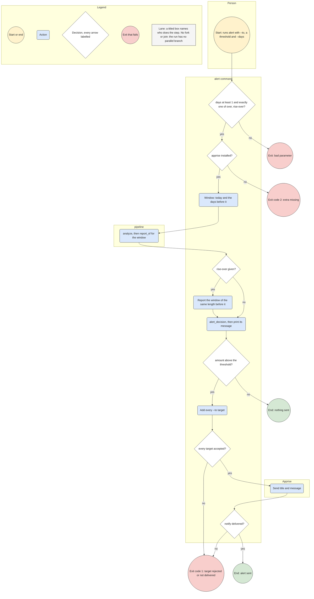

# Spend alert run

This view walks through one run of the spend alert, from the options the person types to the message that reaches their phone or chat. It shows which mistakes stop the run early and when the run ends quietly because spend stayed under the limit. It helps anyone who schedules the alert understand why it did or did not fire.

## What the diagram shows

- The window length must be at least one day, and exactly one of the two thresholds must be given, or the command stops with a parameter error. `src/ai_usage_cost/cli.py:320-326`
- The notification library is an optional extra; without it the command prints the install hint and exits with code 2. `src/ai_usage_cost/cli.py:327` `src/ai_usage_cost/cli.py:48-56`
- The window ends today and starts the given number of days back, counting today. `src/ai_usage_cost/cli.py:329-330`
- The run analyses the store and builds the report of that window. `src/ai_usage_cost/cli.py:331-332`
- With the rise threshold, a second report covers the window of the same length just before. `src/ai_usage_cost/cli.py:333-337`
- The decision compares the window total with the total threshold, or the rise over the earlier window with the rise threshold, and fires only when the amount is strictly above it. `src/ai_usage_cost/cli.py:257-282`
- The message also names the tokens, requests and sessions, and says which cost is unknown rather than zero: unpriced models and sessions without token counts. `src/ai_usage_cost/cli.py:273-295`
- The message is always printed; when the decision does not fire, nothing is sent. `src/ai_usage_cost/cli.py:340-342`
- Each target address is added in turn, and a rejected address or a failed delivery ends the run with code 1. `src/ai_usage_cost/cli.py:344-354`

## Capability and related functionality

- Realises the use case be alerted when spend rises, one of the goals in [[Usage cost goals]].
- The two windows are drawn on a calendar in [[Alert comparison windows]], and the refusals beside the other commands in [[Usage cost refusals]].
- The analysis step is drawn in [[Scan pipeline from logs to report]], and the commands are described in [[Ai usage cost Workflows]].

## Spend alert run

%% generated:diagram-spend-alert-run start (do not edit; run brain docs generate) %%

%% generated:diagram-spend-alert-run end %%

> [!example]- Code references
> | Code | What it shows |
> |---|---|
> | `src/ai_usage_cost/cli.py:298-354` | The alert command |
> | `src/ai_usage_cost/cli.py:251-295` | The decision and the excluded cost line |
> | `src/ai_usage_cost/cli.py:48-56` | The optional extra check |
