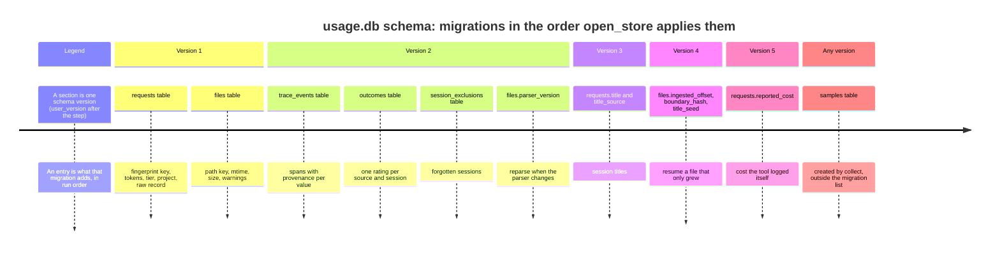

# Store schema versions

This view shows how the local database grew, one version at a time, in the order the tool upgrades an older file. It tells a reader which data an old database lacks until the tool opens it once. It also explains why a database opened by a newer version cannot simply be read by an older one.

## What the diagram shows

- Opening the store reads the schema version, runs every later migration in list order and records the new version after each one. `src/ai_usage_cost/store.py:140-151`
- Version 1 creates the requests table keyed by fingerprint and the files table keyed by path. `src/ai_usage_cost/store.py:22-41`
- Version 2 adds the trace, outcome and exclusion tables and a parser version on each file. `src/ai_usage_cost/store.py:42-74`
- Version 3 adds a session title and where the title came from. `src/ai_usage_cost/store.py:75-78`
- Version 4 adds the offset, boundary hash and title seed that let a grown file be read from where the last scan stopped. `src/ai_usage_cost/store.py:79-83` `src/ai_usage_cost/store.py:241-253`
- Version 5 adds the cost the tool logged itself. `src/ai_usage_cost/store.py:84-87`
- The parser version is a separate number, and a file stored under an older one is parsed again in full. `src/ai_usage_cost/store.py:89` `src/ai_usage_cost/store.py:229-231`
- The samples table is created by the GPU sampler with its own statement, not by a migration. `src/ai_usage_cost/collect.py:18-25` `src/ai_usage_cost/collect.py:59-61`

## Capability and related functionality

- The tables and their fields are in [[Ai usage cost Data Model]], and where each table is filled from is drawn in [[Where usage cost data comes from]].
- The resume rule that version 4 enables is part of [[Scan and report process]].
- There is no downgrade step: migrations only run forward from the stored version (`src/ai_usage_cost/store.py:146-150`). Running the tool is covered in [[Ai usage cost Operations]].

## Store schema versions

%% generated:diagram-store-schema-versions start (do not edit; run brain docs generate) %%

%% generated:diagram-store-schema-versions end %%

> [!example]- Code references
> | Code | What it shows |
> |---|---|
> | `src/ai_usage_cost/store.py:21-87` | The migration list |
> | `src/ai_usage_cost/store.py:140-151` | How the migrations are applied |
> | `src/ai_usage_cost/store.py:89` | The parser version |
> | `src/ai_usage_cost/collect.py:18-25` | The samples table statement |
