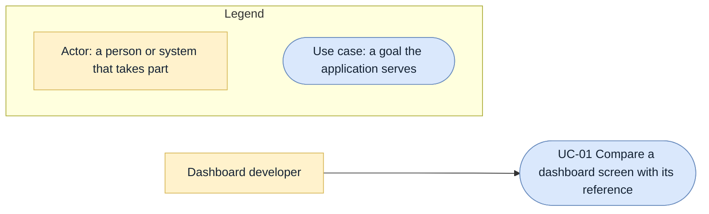

# UC-01 Compare a dashboard screen with its reference Use Case Diagram

The actors that take part in UC-01 Compare a dashboard screen with its reference, drawn from the specification.

## Use case diagram

%% generated:diagram-use-case-uc-01 start (do not edit; run brain docs generate) %%

%% generated:diagram-use-case-uc-01 end %%

%% generated:node-citations-use-case-uc-01 start (do not edit; run brain docs generate) %%
### Node citations

- UC-01 Compare a dashboard screen with its reference: `web/prototype.html:25`, `web/src/prototype/main.tsx:9`, `web/src/prototype/Prototype.tsx:16`
%% generated:node-citations-use-case-uc-01 end %%
