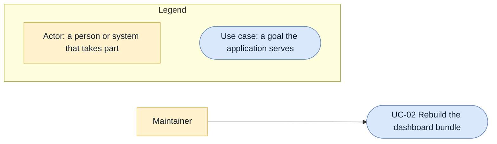

# UC-02 Rebuild the dashboard bundle Use Case Diagram

The actors that take part in UC-02 Rebuild the dashboard bundle, drawn from the specification.

## Use case diagram

%% generated:diagram-use-case-uc-02 start (do not edit; run brain docs generate) %%

%% generated:diagram-use-case-uc-02 end %%

%% generated:node-citations-use-case-uc-02 start (do not edit; run brain docs generate) %%
### Node citations

- UC-02 Rebuild the dashboard bundle: `web/package.json:8`, `web/vite.config.ts:16`, `web/vite.config.ts:7`
%% generated:node-citations-use-case-uc-02 end %%
