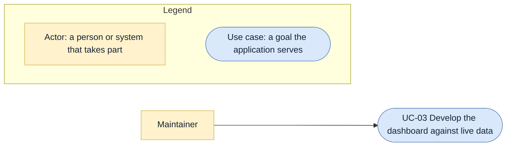

# UC-03 Develop the dashboard against live data Use Case Diagram

The actors that take part in UC-03 Develop the dashboard against live data, drawn from the specification.

## Use case diagram

%% generated:diagram-use-case-uc-03 start (do not edit; run brain docs generate) %%

%% generated:diagram-use-case-uc-03 end %%

%% generated:node-citations-use-case-uc-03 start (do not edit; run brain docs generate) %%
### Node citations

- UC-03 Develop the dashboard against live data: `web/package.json:7`, `web/vite.config.ts:19`, `web/vite.config.ts:22`
%% generated:node-citations-use-case-uc-03 end %%
