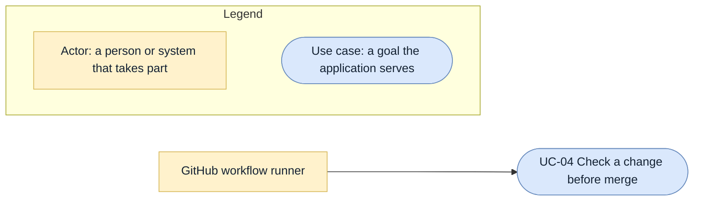

# UC-04 Check a change before merge Use Case Diagram

The actors that take part in UC-04 Check a change before merge, drawn from the specification.

## Use case diagram

%% generated:diagram-use-case-uc-04 start (do not edit; run brain docs generate) %%

%% generated:diagram-use-case-uc-04 end %%

%% generated:node-citations-use-case-uc-04 start (do not edit; run brain docs generate) %%
### Node citations

- UC-04 Check a change before merge: `.github/workflows/python.yml:6`, `.github/workflows/python.yml:54`, `.github/workflows/web.yml:46`
%% generated:node-citations-use-case-uc-04 end %%
