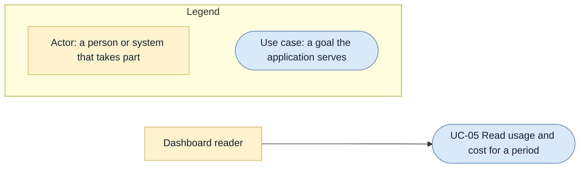

# UC-05 Read usage and cost for a period Use Case Diagram

The actors that take part in UC-05 Read usage and cost for a period, drawn from the specification.

## Use case diagram

%% generated:diagram-use-case-uc-05 start (do not edit; run brain docs generate) %%

%% generated:diagram-use-case-uc-05 end %%

%% generated:node-citations-use-case-uc-05 start (do not edit; run brain docs generate) %%
### Node citations

- UC-05 Read usage and cost for a period: `web/src/App.tsx:168`, `web/src/App.tsx:186`, `web/src/App.tsx:333`
%% generated:node-citations-use-case-uc-05 end %%
