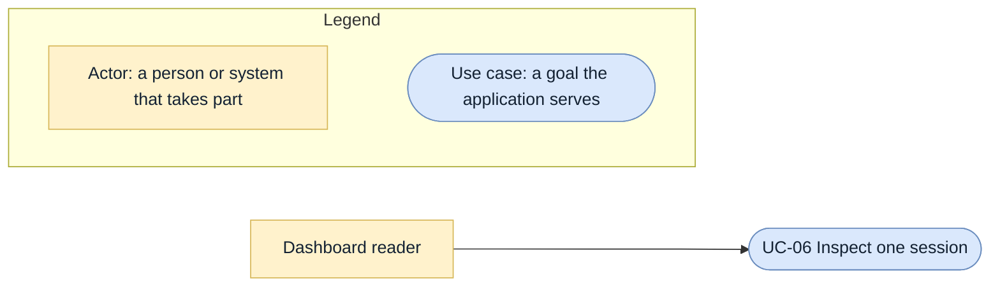

# UC-06 Inspect one session Use Case Diagram

The actors that take part in UC-06 Inspect one session, drawn from the specification.

## Use case diagram

%% generated:diagram-use-case-uc-06 start (do not edit; run brain docs generate) %%

%% generated:diagram-use-case-uc-06 end %%

%% generated:node-citations-use-case-uc-06 start (do not edit; run brain docs generate) %%
### Node citations

- UC-06 Inspect one session: `web/src/App.tsx:287`, `web/src/SessionWorkspace.tsx:471`, `web/src/SessionWorkspace.tsx:472`
%% generated:node-citations-use-case-uc-06 end %%
