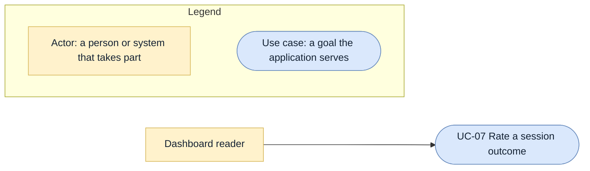

# UC-07 Rate a session outcome Use Case Diagram

The actors that take part in UC-07 Rate a session outcome, drawn from the specification.

## Use case diagram

%% generated:diagram-use-case-uc-07 start (do not edit; run brain docs generate) %%

%% generated:diagram-use-case-uc-07 end %%

%% generated:node-citations-use-case-uc-07 start (do not edit; run brain docs generate) %%
### Node citations

- UC-07 Rate a session outcome: `web/src/SessionWorkspace.tsx:312`, `web/src/api.ts:577`, `web/src/SessionWorkspace.tsx:287`
%% generated:node-citations-use-case-uc-07 end %%
