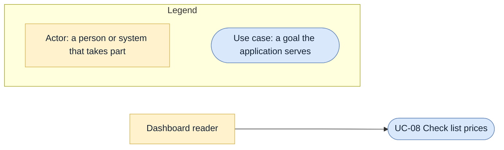

# UC-08 Check list prices Use Case Diagram

The actors that take part in UC-08 Check list prices, drawn from the specification.

## Use case diagram

%% generated:diagram-use-case-uc-08 start (do not edit; run brain docs generate) %%

%% generated:diagram-use-case-uc-08 end %%

%% generated:node-citations-use-case-uc-08 start (do not edit; run brain docs generate) %%
### Node citations

- UC-08 Check list prices: `web/src/App.tsx:337`, `web/src/Pricing.tsx:128`, `web/src/Pricing.tsx:106`
%% generated:node-citations-use-case-uc-08 end %%
