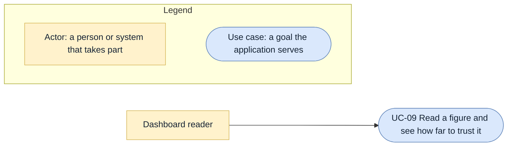

# UC-09 Read a figure and see how far to trust it Use Case Diagram

The actors that take part in UC-09 Read a figure and see how far to trust it, drawn from the specification.

## Use case diagram

%% generated:diagram-use-case-uc-09 start (do not edit; run brain docs generate) %%

%% generated:diagram-use-case-uc-09 end %%

%% generated:node-citations-use-case-uc-09 start (do not edit; run brain docs generate) %%
### Node citations

- UC-09 Read a figure and see how far to trust it: `web/src/components/stat.tsx:61`, `web/src/components/status.tsx:149`, `web/src/components/status.tsx:180`
%% generated:node-citations-use-case-uc-09 end %%
