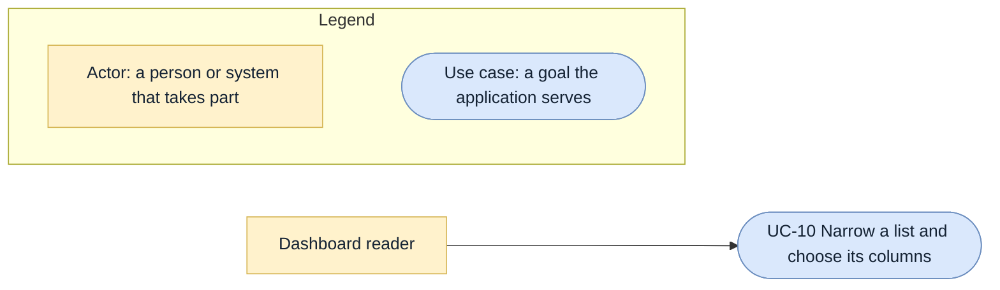

# UC-10 Narrow a list and choose its columns Use Case Diagram

The actors that take part in UC-10 Narrow a list and choose its columns, drawn from the specification.

## Use case diagram

%% generated:diagram-use-case-uc-10 start (do not edit; run brain docs generate) %%

%% generated:diagram-use-case-uc-10 end %%

%% generated:node-citations-use-case-uc-10 start (do not edit; run brain docs generate) %%
### Node citations

- UC-10 Narrow a list and choose its columns: `web/src/components/filters.tsx:18`, `web/src/components/filters.tsx:195`, `web/src/components/filters.tsx:156`
%% generated:node-citations-use-case-uc-10 end %%
