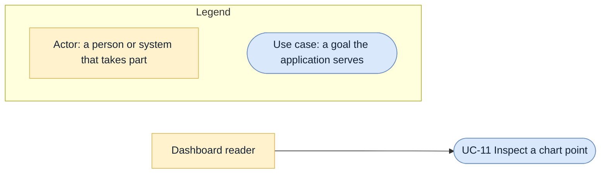

# UC-11 Inspect a chart point Use Case Diagram

The actors that take part in UC-11 Inspect a chart point, drawn from the specification.

## Use case diagram

%% generated:diagram-use-case-uc-11 start (do not edit; run brain docs generate) %%

%% generated:diagram-use-case-uc-11 end %%

%% generated:node-citations-use-case-uc-11 start (do not edit; run brain docs generate) %%
### Node citations

- UC-11 Inspect a chart point: `web/src/components/chart-hover.tsx:43`, `web/src/components/chart-hover.tsx:63`, `web/src/components/chart-hover.tsx:91`
%% generated:node-citations-use-case-uc-11 end %%
