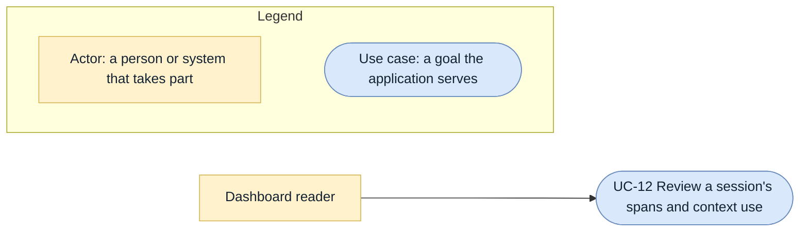

# UC-12 Review a session's spans and context use Use Case Diagram

The actors that take part in UC-12 Review a session's spans and context use, drawn from the specification.

## Use case diagram

%% generated:diagram-use-case-uc-12 start (do not edit; run brain docs generate) %%

%% generated:diagram-use-case-uc-12 end %%

%% generated:node-citations-use-case-uc-12 start (do not edit; run brain docs generate) %%
### Node citations

- UC-12 Review a session's spans and context use: `web/src/components/trace.tsx:227`, `web/src/components/trace.tsx:247`, `web/src/components/trace.tsx:389`
%% generated:node-citations-use-case-uc-12 end %%
