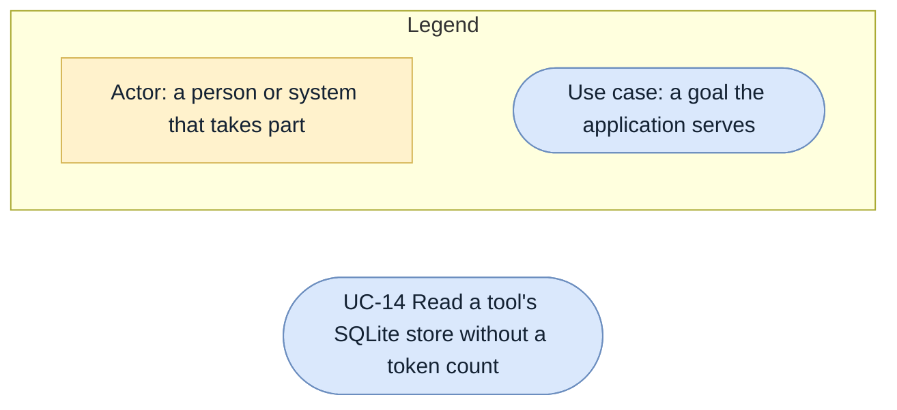

# UC-14 Read a tool's SQLite store without a token count Use Case Diagram

The actors that take part in UC-14 Read a tool's SQLite store without a token count, drawn from the specification.

## Use case diagram

%% generated:diagram-use-case-uc-14 start (do not edit; run brain docs generate) %%

%% generated:diagram-use-case-uc-14 end %%

%% generated:node-citations-use-case-uc-14 start (do not edit; run brain docs generate) %%
### Node citations

- UC-14 Read a tool's SQLite store without a token count: `src/ai_usage_cost/sources/cursor.py:32`, `src/ai_usage_cost/sources/cursor.py:55`, `src/ai_usage_cost/sources/cursor.py:59`
%% generated:node-citations-use-case-uc-14 end %%
