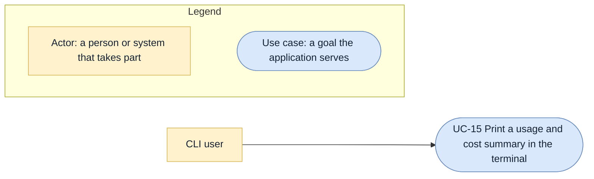

# UC-15 Print a usage and cost summary in the terminal Use Case Diagram

The actors that take part in UC-15 Print a usage and cost summary in the terminal, drawn from the specification.

## Use case diagram

%% generated:diagram-use-case-uc-15 start (do not edit; run brain docs generate) %%

%% generated:diagram-use-case-uc-15 end %%

%% generated:node-citations-use-case-uc-15 start (do not edit; run brain docs generate) %%
### Node citations

- UC-15 Print a usage and cost summary in the terminal: `src/ai_usage_cost/cli.py:105`, `src/ai_usage_cost/render/terminal.py:20`, `src/ai_usage_cost/render/terminal.py:29`
%% generated:node-citations-use-case-uc-15 end %%
