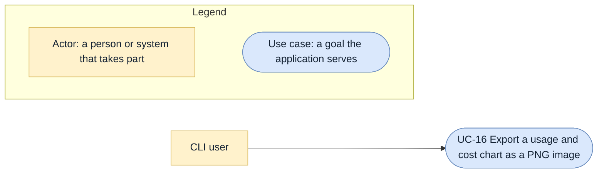

# UC-16 Export a usage and cost chart as a PNG image Use Case Diagram

The actors that take part in UC-16 Export a usage and cost chart as a PNG image, drawn from the specification.

## Use case diagram

%% generated:diagram-use-case-uc-16 start (do not edit; run brain docs generate) %%

%% generated:diagram-use-case-uc-16 end %%

%% generated:node-citations-use-case-uc-16 start (do not edit; run brain docs generate) %%
### Node citations

- UC-16 Export a usage and cost chart as a PNG image: `src/ai_usage_cost/cli.py:186`, `src/ai_usage_cost/cli.py:192`, `src/ai_usage_cost/render/png.py:26`
%% generated:node-citations-use-case-uc-16 end %%
