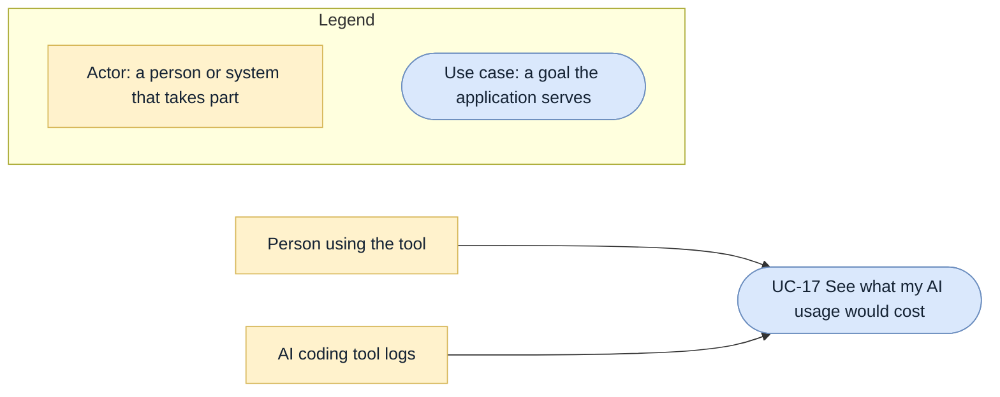

# UC-17 See what my AI usage would cost Use Case Diagram

The actors that take part in UC-17 See what my AI usage would cost, drawn from the specification.

## Use case diagram

%% generated:diagram-use-case-uc-17 start (do not edit; run brain docs generate) %%

%% generated:diagram-use-case-uc-17 end %%

%% generated:node-citations-use-case-uc-17 start (do not edit; run brain docs generate) %%
### Node citations

- UC-17 See what my AI usage would cost: `src/ai_usage_cost/cli.py:72`, `src/ai_usage_cost/cli.py:87`, `src/ai_usage_cost/pipeline.py:175`
%% generated:node-citations-use-case-uc-17 end %%
