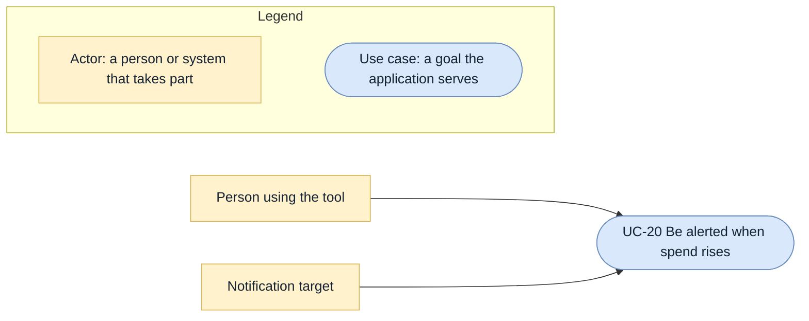

# UC-20 Be alerted when spend rises Use Case Diagram

The actors that take part in UC-20 Be alerted when spend rises, drawn from the specification.

## Use case diagram

%% generated:diagram-use-case-uc-20 start (do not edit; run brain docs generate) %%

%% generated:diagram-use-case-uc-20 end %%

%% generated:node-citations-use-case-uc-20 start (do not edit; run brain docs generate) %%
### Node citations

- UC-20 Be alerted when spend rises: `src/ai_usage_cost/cli.py:299`, `src/ai_usage_cost/cli.py:323`, `src/ai_usage_cost/cli.py:335`
%% generated:node-citations-use-case-uc-20 end %%
