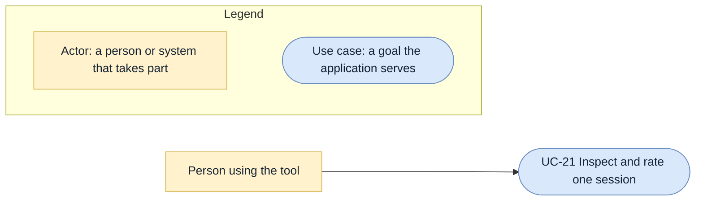

# UC-21 Inspect and rate one session Use Case Diagram

The actors that take part in UC-21 Inspect and rate one session, drawn from the specification.

## Use case diagram

%% generated:diagram-use-case-uc-21 start (do not edit; run brain docs generate) %%

%% generated:diagram-use-case-uc-21 end %%

%% generated:node-citations-use-case-uc-21 start (do not edit; run brain docs generate) %%
### Node citations

- UC-21 Inspect and rate one session: `src/ai_usage_cost/api.py:321`, `src/ai_usage_cost/api.py:240`, `src/ai_usage_cost/api.py:336`
%% generated:node-citations-use-case-uc-21 end %%
