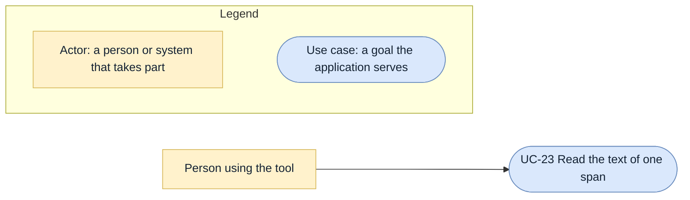

# UC-23 Read the text of one span Use Case Diagram

The actors that take part in UC-23 Read the text of one span, drawn from the specification.

## Use case diagram

%% generated:diagram-use-case-uc-23 start (do not edit; run brain docs generate) %%

%% generated:diagram-use-case-uc-23 end %%

%% generated:node-citations-use-case-uc-23 start (do not edit; run brain docs generate) %%
### Node citations

- UC-23 Read the text of one span: `src/ai_usage_cost/api.py:374`, `src/ai_usage_cost/api.py:376`, `src/ai_usage_cost/privacy.py:91`
%% generated:node-citations-use-case-uc-23 end %%
