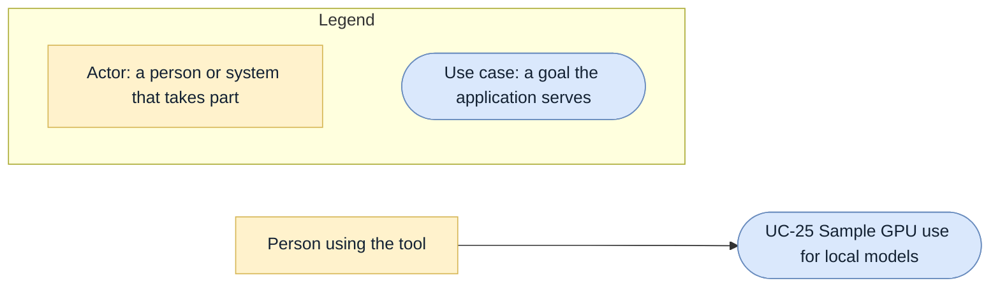

# UC-25 Sample GPU use for local models Use Case Diagram

The actors that take part in UC-25 Sample GPU use for local models, drawn from the specification.

## Use case diagram

%% generated:diagram-use-case-uc-25 start (do not edit; run brain docs generate) %%

%% generated:diagram-use-case-uc-25 end %%

%% generated:node-citations-use-case-uc-25 start (do not edit; run brain docs generate) %%
### Node citations

- UC-25 Sample GPU use for local models: `src/ai_usage_cost/cli.py:200`, `src/ai_usage_cost/collect.py:85`, `src/ai_usage_cost/collect.py:275`
%% generated:node-citations-use-case-uc-25 end %%
