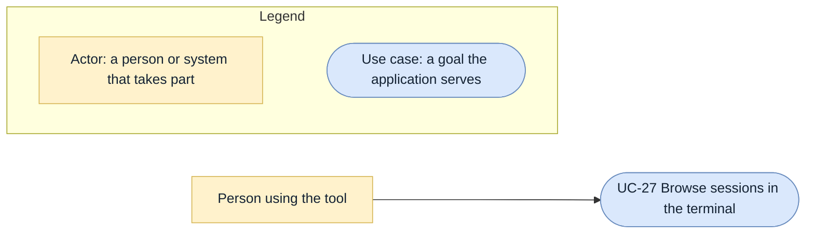

# UC-27 Browse sessions in the terminal Use Case Diagram

The actors that take part in UC-27 Browse sessions in the terminal, drawn from the specification.

## Use case diagram

%% generated:diagram-use-case-uc-27 start (do not edit; run brain docs generate) %%

%% generated:diagram-use-case-uc-27 end %%

%% generated:node-citations-use-case-uc-27 start (do not edit; run brain docs generate) %%
### Node citations

- UC-27 Browse sessions in the terminal: `src/ai_usage_cost/cli.py:358`, `src/ai_usage_cost/cli.py:371`, `src/ai_usage_cost/tui.py:119`
%% generated:node-citations-use-case-uc-27 end %%
